# 🚀 NewOS

<p align="center">
  <em>A 32-bit x86 micro operating system, hand-written from scratch</em><br>
  <em>From a 512-byte boot sector to "write C, compile it, and run it — inside your own OS"</em>
</p>

<p align="center">
  <a href="README.md">中文</a> · English
</p>

<p align="center">
  
  
  
  
</p>

<p align="center">
  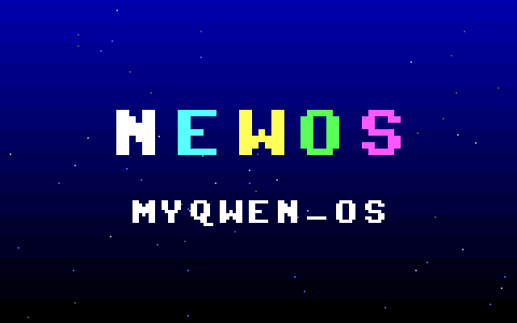
</p>

NewOS is an educational 32-bit x86 operating system written from scratch in C and a bit of assembly, running in QEMU. It covers the full OS learning path: **booting → protected mode → interrupts → memory management → multitasking → graphics → persistent filesystem → editor → C compiler → Ring 3 user mode → user-mode shell** — so that in the end you can write and compile C programs, load flat or ELF32 executables from `/bin`, manage processes with `fork/waitpid/execve`, and use pipes, redirection, and background jobs. Files, directories, and `/bin` survive reboots.

## ✨ Features

### 🖥️ Core
- **Bootloader**: a hand-written 512-byte boot sector that loads the kernel from a floppy (448 KB load window, with 64 KB segment wrap-around handling)
- **Protected mode**: GDT segmentation, A20 gate, 32-bit mode switch
- **Memory management**: BIOS E820 map parsing + reserved-page protection + reference-counted physical pages + `kmalloc/kfree/krealloc` kernel heap + 32 MB identity-mapped paging
- **Per-process virtual memory**: independent page directories/tables, zero-filled demand pages, fork COW, stack guard page, shrinking `brk`, and an anonymous `mmap` arena
- **Executables and process lifecycle**: `/bin` accepts flat and ELF32 images, parses PT_LOAD/data/BSS, constructs `argc/argv/envp` stacks, and implements `fork/waitpid/execve` with transactional replacement and child reaping
- **Interrupts**: full IDT (32 exception handlers + IRQs + syscall gate), 8259A PIC remap, PS/2 keyboard interrupt driver
- **Real-mode round trips**: drop back to real mode to call the BIOS (video mode switching) and return to protected mode automatically — the trampoline saves/restores all callee-saved registers

### 🛡️ Ring 3 User Mode
- **Privilege isolation**: TSS kernel-stack switch, user code/data segments (DPL3), page-table U/S protection — a user program touching kernel memory gets a #PF
- **System calls**: `int 0x80` (DPL3 gate) — putc/puts/get_ticks/exit/fork/waitpid/getpid/sleep/brk/mmap/execve/open/read/write/close/lseek/chdir/getcwd/mkdir/pipe/dup/dup2/remove/readdir/rename/stat/link/truncate/sigaction/sigprocmask/sigreturn/setpgid/tcsetpgrp/kill; user pointers are validated page by page, failures carry negative errno values, and the user library returns `-1` with `errno` set
- **User signals**: install or ignore `SIGINT/SIGTERM/SIGCONT`, with a pending bitmap, signal mask, automatic current-signal blocking, and a SysV-style user-stack return frame
- **Default user shell 3.0**: normal boot enters a Ring 3 `sh:/>`; supports quoting, escapes, `$VAR/$?`, field splitting, `*`/`?` globbing, `$(...)` command substitution, multiline input, scripts and `sh -c`, in-line editing, Ctrl+R history search, Tab completion, persistent history, mutable environments, `;`, `2>/2>&1`, four-stage pipelines, process groups, signals, jobs, and `mv/ln/truncate/stat/ls -l`. `exit` enters the kernel recovery shell
- **Exception handling**: 32 exception handlers print the full fault context (EIP/CS/EFLAGS/ESP/CR2 + page-fault error code P/W/U decoding); a user-mode fault kills the process and returns to the shell, a kernel-mode fault panics
- **23 flat programs + 1 ELF32 demo**: coverage includes the user shell, signal handling, POSIX errno, shared opens, pipes, waitpid, execve, ELF32, fork heap isolation, the free-list allocator, per-process working directories, and filesystem concurrency stress

### ⏱️ Multitasking & Devices
- **Preemptive multitasking**: PIT IRQ0 (18.2 Hz) round-robin scheduling; cooperative and preemptive context frames are mutually restorable; includes a "bully task" demo
- **Full process lifecycle**: per-process address spaces and CWDs, fork, process groups, RUNNING/STOPPED jobs, process reaping, and a 16-entry per-process fd table; stopping preserves all VM/fd state for resume
- **Device drivers**: ATA PIO disk, VGA text/graphics, COM1 serial, PS/2 keyboard, PIT timer, PC speaker beep
- **Graphics library**: mode 13h (320×200×256) palette/pixel/rect/sprite/font
- **🎨 Adjustable fonts**: pure VGA hardware programming with 5 eight-pixel-wide bitmap fonts (Terminus, Goha, Goha Classic, VGA Console, DOS); the `font` command supports **any 8–32px height** combined with a font style, scaling non-native sizes at load time and running a hardware self-test each time

### 📁 Filesystem
xv6-style teaching implementation (ATA PIO persistent disk, 1 MB / 256 blocks, 64 inodes):
- Superblock + inode/block bitmaps + 64-byte inodes (12 direct blocks plus a single-indirect block, removing the 48 KB structural limit)
- Chained directory entries, real `.`/`..` entries, unified absolute/relative path resolution
- Shell commands: `pwd` `ls` `cd` `mkdir` `touch` `cat` `rm` `mv` `ln` `truncate` `stat` `echo >` `df` `sync`
- Bounded 4 KB dirty-block cache with threshold/periodic writeback, close/reboot flushing, and explicit `sync`
- Sleeping single-writer mutex; waiters sleep on `TASK_WAIT_FS` instead of blocking IRQs during large ATA I/O
- Metadata redo journal: home blocks are updated only after a committed journal header; committed transactions replay at boot
- POSIX-style rename replacement, hard links, byte-range growth/truncation, moved-directory `..` updates, and metadata queries
- Removal protection (cannot delete cwd or its ancestors), reboot persistence tests, and a boot self-test (create → write → read back → delete)

### ✏️ Built-in Editor
A nano-style `edit` command:
- Arrow keys / Home / End / PgUp / PgDn navigation, Ctrl+Arrow word movement, Ctrl+Backspace word deletion
- **Ctrl+Z / Ctrl+Y undo and redo**, **Ctrl+F search**, **Ctrl+G go to line**
- **Ctrl+S to save, Ctrl+X to exit** (save, discard, or cancel when modified)
- Exact line/column cursor highlighting (fixes newline ghosts), status bar, horizontal scrolling of long lines
- Polls the 8042 directly and tracks Shift/Ctrl/CapsLock/0xE0 extended-key prefixes itself

A vi-style `vi` command reuses the same text buffer:

- Normal/Insert/Command modes, `i/a/o`, `h/j/k/l`, `0/$`, `w/b`
- `x`, `dd`, `yy`, `p`, `dw`, `d$`
- `/`/`n` search, `u`/Ctrl+R undo/redo
- `:w`, `:q`, `:q!`, `:wq`/`:x`

### ⚙️ C Compiler (c4 port)
The `cc` command — a port of **C in four functions** (by Robert Swierczek), compiling a C subset to a built-in stack virtual machine:

| Supported | Notes |
|---|---|
| Types | `char`, `int`, pointers, 1-D arrays, `enum`, `sizeof` |
| Declarations | May have initializers: `int a = 5;` (global & local; globals run before `main`) |
| Statements | `if/else`, `while`, `do/while`, `for`, `break/continue`, `return`, expressions, function calls (incl. recursion) |
| Comments | `//` and `/* */` |
| Builtins | `printf` `open` `read` `close` `malloc` `free` `memset` `memcmp` `exit` |
| Not supported | struct/union, float, switch, goto, preprocessor; avoid `&&` `\|\|` `?:` in for-increment / global-initializer expressions (deferred-codegen limitation) |

**`open/read` talk to the OS's own filesystem** — C programs can read files inside the OS! Compile errors include line numbers; runaway loops can be interrupted with ESC.

### 🎮 Fun & Applications
- **Tetris**: 7-bag randomizer, wall kicks, lock delay, hold piece, line-clear animation, 5 color themes, beep SFX
- **Super Mario**: two themed stages, super/star abilities, checkpoints, stomp combos, variable jumps, jump buffering/coyote time, particles, screen shake, mid-stage retry, and a polished HUD
- **🚀 Boot screen**: deep-blue gradient starfield (DAC palette programming) + 32px high-contrast "NEWOS" letter-by-letter reveal animation + "MYQWEN-OS" subtitle; press any key to skip; replayable via the `splash` command

## 💻 Command Reference

| Command | Description |
|---|---|
| `help` | List all commands |
| `history [N]` | Show the last N commands; Up/Down recalls them |
| `NAME=value` / `export NAME` / `unset NAME` | Set a local variable, export it, or remove it |
| `set` / `env` | Show all shell variables / the exported environment |
| `clear` | Clear the screen |
| `meminfo` | Memory statistics (pages) |
| `memmap` | Show the BIOS E820 memory map |
| `heap` | Show kernel heap statistics and integrity |
| `heap blocks` | Show heap blocks after split/coalesce |
| `heaptest` | Run allocation/reallocation/free stress test |
| `echo [text]` | Print text; `echo text > file` writes (overwrites) a file |
| `date` | CMOS real-time clock |
| `version` / `reboot` | Version / reboot |
| `ps` / `start` / `stop` | Task status / start-stop the multitasking demo |
| `testmode` | Graphics-mode real-mode round-trip test |
| `tetris` / `mario` | Games (ESC to exit) |
| `font N` / `font <style> [N]` | Any 8–32px size / font style + size; use `font list` for styles |
| `pwd` | Print working directory |
| `ls [dir]` | List directory (`<DIR>` marks directories) |
| `cd [dir]` | Change directory (no arg = root) |
| `mkdir dir` | Create a directory |
| `touch file` | Create an empty file |
| `cat file` | Show file contents |
| `rm path` | Remove a file or empty directory |
| `mv old new` | Rename/move; files replace files and directories replace empty directories |
| `ln old new` | Create a hard link to a regular file |
| `truncate file N` | Grow or shrink a file to N bytes |
| `stat path` | Show type, size, link count and inode number |
| `df` | Filesystem usage |
| `sync` | Force delayed writes and the metadata journal to disk |
| `edit file` | Open the editor (^S save, ^X asks to save on exit) |
| `vi file` | Open the vi-style editor (Esc returns to Normal; `:wq` saves and exits) |
| `cc file.c [args...]` | Compile and run a C program (args go to main) |
| `run prog [args] [&]` | Run an embedded or `/bin` executable (`args` enter the initial stack; `&` = detached background) |
| `run sh` | Re-enter the user shell from recovery mode (the normal image already starts there) |
| `sh FILE` / `sh -c CMD` | Run a script or command string in a separate user shell |
| `splash` | Replay the boot screen |

## 🚀 Quick Start

**Requirements** (Arch Linux): `nasm`, `gcc` (32-bit support), `ld`, `objcopy`, `qemu-system-i386`

```bash
make          # build Ring-3 os.img and recovery os-kernel.img
make run      # run in QEMU; build/disk.img stores the persistent filesystem
make debug    # QEMU + GDB source-level debugging (port 1234)
make clean    # clean up
```

After boot, a ~4 second boot screen plays (press any key to skip), then the normal image enters a Ring 3 shell:

```
sh:/> help
```

Type `exit` to enter the kernel recovery shell (`OS:/>`) for kernel services such as `font/tetris/edit/cc/splash`.

## 📝 Typical Workflow

```
OS:/> mkdir src
OS:/> cd src
OS:/src> edit hello.c          ← write a C program in the editor
OS:/src> cc hello.c            ← compile and run
hello from C! (42)
exit(0) cycle = 11
```

Even cooler: a C program reading the OS's own filesystem —

```c
int main() { int fd; char *buf; int n;
fd = open("/data.txt", 0); buf = malloc(32);
n = read(fd, buf, 31); buf[n] = 0;
printf("read %d: %s\n", n, buf); return 0; }
```

## 📷 Screenshots

| Filesystem operations | Built-in editor | C compile & run |
|---|---|---|
| 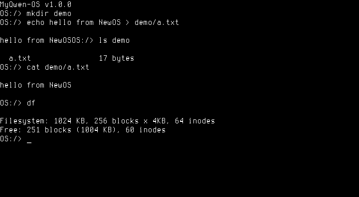 | 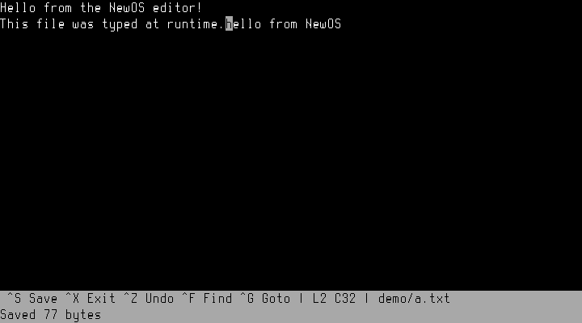 | 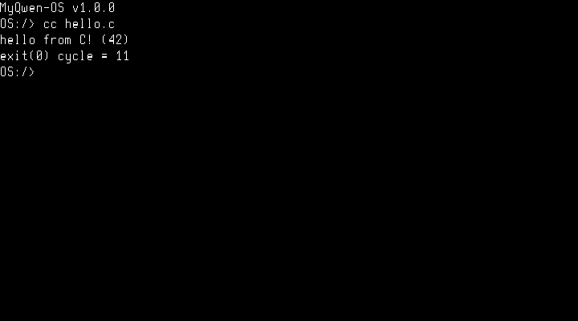 |

| Default Ring 3 shell | Kernel recovery shell |
|---|---|
| 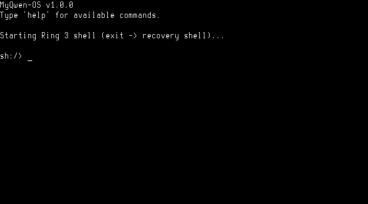 | 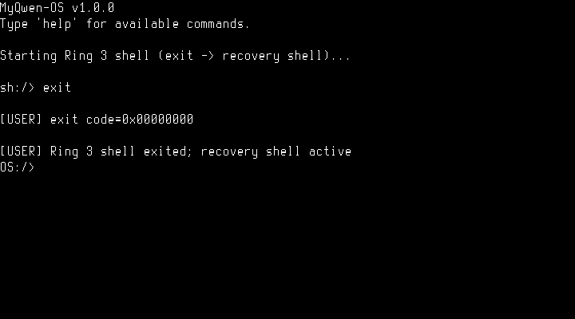 |

| Ring 3 user mode | User fault caught by the kernel |
|---|---|
| 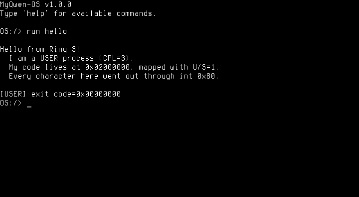 | 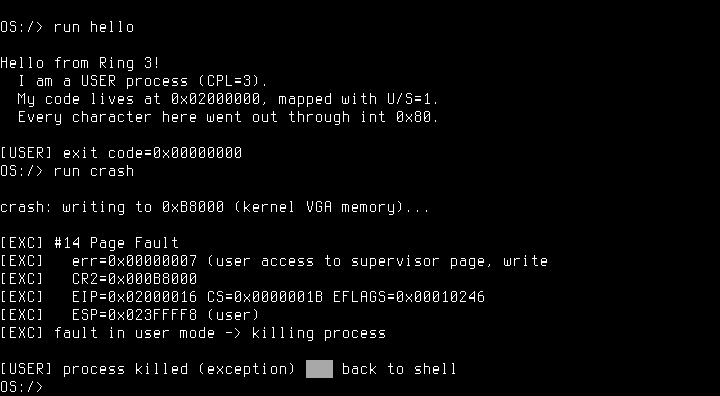 |

| User heap + fork heap isolation + waitpid |
|---|
| 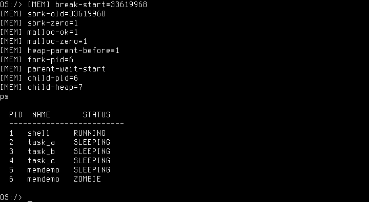 |

| Super Mario title | Super Mario gameplay |
|---|---|
| 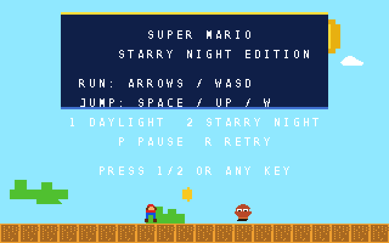 | 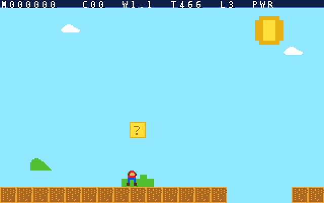 |

## 🧪 Automated Tests

24 serial-driven headless test suites (QEMU monitor key injection + kernel serial marker assertions):

```bash
python3 tools/test-memory.py  # E820 + page allocator + kernel heap (15 checks)
python3 tools/test-splash.py   # boot screen  (14 checks)
python3 tools/test-font.py     # fonts        (30 checks)
python3 tools/test-fs.py       # filesystem   (43 checks)
python3 tools/test-disk.py     # ATA/mount/reboot persistence (19 checks)
python3 tools/test-fs2.py      # indirect blocks/rename/hard links/truncate/reboot
python3 tools/test-fs-journal.py # committed-journal power-loss replay
python3 tools/test-signals.py  # user handler/mask/pending/sigreturn
python3 tools/test-boot-shell.py # normal Ring 3 boot / recovery kernel shell
python3 tools/test-edit.py     # editor/undo/find/caret (67 checks)
python3 tools/test-vi.py       # vi modes/motions/yank/search/commands (28 checks)
python3 tools/test-cc.py       # C compiler   (41 checks)
python3 tools/test-preempt.py  # preemption   (7 checks)
python3 tools/test-mario.py    # Mario/powerups/UI/two themes (18 checks)
python3 tools/test-user.py     # Ring 3 user  (36 checks)
python3 tools/test-sched.py    # PCB scheduler + keyboard buffer (15 checks)
python3 tools/test-proc.py     # processes/fork/background/kill (36 checks)
python3 tools/test-memproc.py  # user heap/fork isolation/waitpid (26 checks)
python3 tools/test-alloc.py    # free list/coalescing/realloc (24 checks)
python3 tools/test-vm.py       # demand paging/COW/guard (22 checks)
python3 tools/test-exec.py     # file loader/exec/rollback (26 checks)
python3 tools/test-process.py  # waitpid/argv/envp/ELF32 (39 checks)
python3 tools/test-fd.py       # fd/CWD/shared offsets/pipes/dup2/errno (63 checks)
python3 tools/test-shell.py    # shell/pipelines/env/scripts/jobs (155 checks)
```

> test-preempt / test-mario are attached tests (argv[1] = monitor socket);
> use `python3 tools/run-attached-tests.py` (boots QEMU → waits for the boot screen → runs both).

## 📂 Directory Layout

```
.
├── boot/boot.asm       # 512-byte boot sector
├── kernel/             # kernel source (C + asm)
│   ├── kernel.c        # kernel entry
│   ├── memory.c/h      # E820 parsing + reserved-page protection + physical pages
│   ├── heap.c/h        # kernel heap split/coalesce/realloc/integrity checks
│   ├── paging.c/h      # page directories/tables and mapping primitives
│   ├── ata.c/h         # ATA PIO 28-bit LBA sector I/O
│   ├── vm.c/h          # address spaces, demand paging, COW, brk/mmap
│   ├── exec.c/h        # /bin publishing, flat loader, transactional exec
│   │                    # (vm.c/h also contains the ELF32 loader and initial stack)
│   ├── gdt.c/h         # kernel GDT (user segments + TSS)
│   ├── idt.c/h pic.c   # interrupts & 8259A
│   ├── irq.asm         # IRQ assembly stubs
│   ├── exc.c exc_asm.asm    # exception handlers (32 vectors)
│   ├── user.c/h user_asm.asm user_progs.c user_embed.asm  # Ring 3 user mode
│   ├── keyboard.c      # PS/2 keyboard
│   ├── timer.c/h       # PIT ticks + beeper
│   ├── vga.c/h         # text mode display
│   ├── graphics.c/h    # mode 13h graphics library
│   ├── font.c/h        # VGA character-generator font management
│   ├── font12/14/16.h  # Terminus font data
│   ├── fs.c/h          # indirect blocks, sleeping lock, dirty writeback, redo journal
│   ├── fd.c/h          # shared opens, pipe ring buffers, reference counts
│   ├── editor.c/h      # built-in editor
│   ├── cc.c/h          # c4 compiler port
│   ├── splash.c/h .asm # boot screen
│   ├── tetris.c/h      # Tetris
│   ├── mario.c/h       # Super Mario
│   ├── task.c/h switch.asm   # multitasking
│   ├── realmode.c/h rm_*.asm  # real-mode round-trip trampoline
│   └── keymap.h string.h      # scancode maps / string utils
├── user/               # user-mode demo programs (host-gcc built, incbin'd into the kernel)
│   ├── lib.h           # syscall wrappers (int 0x80)
│   ├── linker.ld       # linked at 0x2000000 (user region)
│   └── hello.c count.c crash.c div0.c echo.c badptr.c forkdemo.c
│       spinner.c vmtest.c vmguard.c execdemo.c execbad.c
│       waittest.c execargv.c elfdemo.c memdemo.c allocdemo.c
│       filedemo.c fdstdin.c sh.c fdpipe.c fscheck.c
├── tetris/             # original real-mode assembly version (port reference)
├── tools/              # font converter + 24 test suites
├── note/               # development notes + screenshots
└── Makefile
```

## 📖 Project History

| Milestone | Content |
|---|---|
| 1 | Real-mode round trips (BIOS calls + graphics modes) |
| 2 | Tetris (1:1 C port of the assembly version) |
| 3 | Preemptive multitasking (PIT IRQ0 time slices) |
| 4 | Super Mario (side-scrolling platformer + camera) |
| 5 | Terminus fonts + 3 sizes (pure VGA hardware programming) |
| 6 | In-memory filesystem + 9 file commands |
| 7 | nano-style built-in editor |
| 8 | c4 mini C compiler (the write-C → compile → run loop) |
| 9 | Boot screen (a 32-bit port & polish of a hand-written hello.asm) |
| 10 | Ring 3 user mode (TSS + page-table U/S protection + int 0x80 syscalls + exception handling) |
| 11 | PCB scheduler + per-process address spaces + fork + background processes |
| 12 | E820 map + reserved-page protection + kernel heap + `memmap`/`heap` diagnostics |
| 13 | Independent virtual address spaces + demand paging + fork COW + guard page + `brk`/`mmap` |
| 14 | `/bin` executables + flat loader + transactional `exec` + PID preservation |
| 15 | `waitpid` + argv/envp stacks + ELF32 PT_LOAD/BSS + read-only code pages |
| 16 | User-space free-list allocator (first fit + splitting + adjacent coalescing + tail shrinking + calloc/realloc) |
| 17 | Editor enhancements (caret ghost fix + undo/redo + find/goto + word navigation) |
| 18 | Mario enhancements (two stages, ability blocks, checkpoint, stomp combos, particles/shake, polished HUD) |
| 19 | Per-process fd table (open/read/write/close/lseek) + per-process CWD + fd 0/1/2 |
| 20 | User shell + echo/cat/ls/pwd/mkdir/rm + shared open objects + pipe/dup2 + `<`/`>`/`>>`/`\|`/`&` |
| 21 | Four-stage pipelines + process groups + foreground Ctrl+C + `jobs/fg/kill/wait` + background reaping |
| 22 | TASK_STOPPED + SIGSTOP/SIGCONT + Ctrl+Z + `WUNTRACED` + `bg` + stopped-job resume |
| 23 | ATA PIO + on-disk superblock/inodes/bitmaps + mount validation + write-through cache + reboot persistence |
| 24 | Single-indirect blocks + filesystem global critical section + `rename/stat` + user `mv`/`ls -l` + concurrent-write tests |
| 25 | Sleeping FS mutex + bounded delayed writeback + metadata redo journal + crash replay + rename replacement/hard links/truncate |
| 26a | User sigaction/sigprocmask/sigreturn + pending/mask + handler stack frame and return trampoline |
| 26b | Normal Ring 3 boot + boot-mode byte + recovery kernel shell/test image |
| 27a | Shell quoting/variables/sequences + stderr redirection + EINTR and job-status fixes |
| 27b | Globs/field splitting + Tab completion + persistent history + `SA_RESTART` |
| 28 | In-line editing/history search + mutable env + command substitution + multiline/scripts |
| 29 | Negative-errno syscall ABI + user errno compatibility + script exit statuses |
| 30 | vi Normal/Insert/Command modes, line operations, search, and `:w/:q/:wq/:q!` |

Detailed development notes, pitfalls and fixes for every milestone live in the `note/` directory (in Chinese).

The step-by-step Chinese guides for the latest phases are
[`docs/MILESTONE_12_E820_HEAP.md`](docs/MILESTONE_12_E820_HEAP.md) and
[`docs/MILESTONE_13_VM.md`](docs/MILESTONE_13_VM.md),
[`docs/MILESTONE_14_EXEC.md`](docs/MILESTONE_14_EXEC.md),
[`docs/MILESTONE_15_PROCESS_ELF.md`](docs/MILESTONE_15_PROCESS_ELF.md),
[`docs/MILESTONE_23_DISK_FS.md`](docs/MILESTONE_23_DISK_FS.md),
[`docs/MILESTONE_24_FS_V2.md`](docs/MILESTONE_24_FS_V2.md).

## 📄 Credits

- **c4** (C in four functions) compiler: originally by Robert Swierczek (public domain); ported here into the kernel
- **Terminus Font**: the classic terminal bitmap font by Dimitar Zhekov
- Early learning plans and notes: `LEARNING_PLAN.md` / `ROADMAP.md` / `docs/` in this repository

> This is a personal learning project; code readability for teaching comes first. Feedback and discussion welcome.
