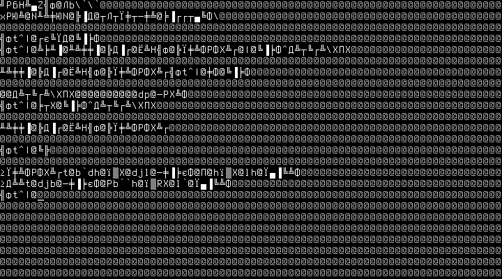
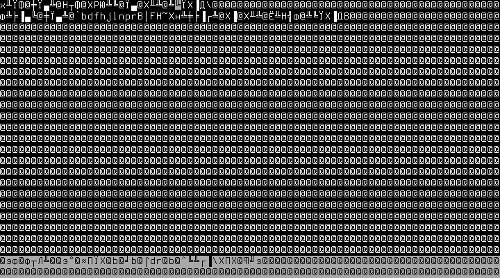
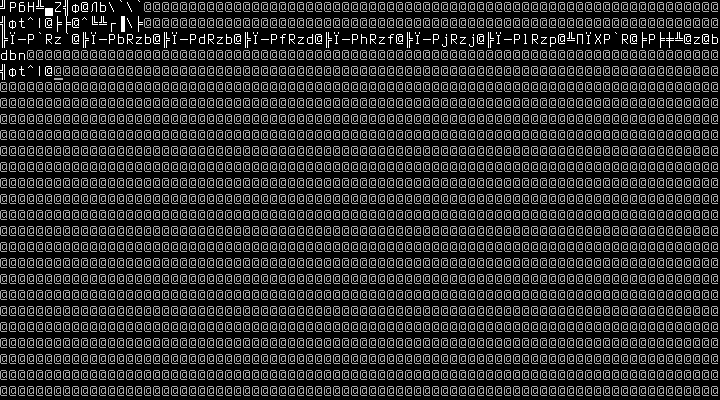

# 🚀 NewOS

<p align="center">
  <em>A 32-bit x86 micro operating system, hand-written from scratch</em><br>
  <em>From a 512-byte boot sector to "write C, compile it, and run it — inside your own OS"</em>
</p>

<p align="center">
  <a href="README.md">中文</a> · English
</p>

<p align="center">
  
  
  
  
</p>

<p align="center">
  
</p>

NewOS is an educational 32-bit x86 operating system written from scratch in C and a bit of assembly, running in QEMU. It covers the full OS learning path: **booting → protected mode → interrupts → memory management → multitasking → graphics → filesystem → editor → C compiler** — so that in the end you can write a C program with the built-in editor, compile it with the built-in compiler, and run it, all inside the OS.

## ✨ Features

### 🖥️ Core
- **Bootloader**: a hand-written 512-byte boot sector that loads the kernel from a floppy (100 KB limit, with 64 KB segment wrap-around handling)
- **Protected mode**: GDT segmentation, A20 gate, 32-bit mode switch
- **Memory management**: bitmap physical page allocator (including contiguous multi-page `alloc_pages`) + paging (32 MB identity mapping)
- **Interrupts**: full IDT, 8259A PIC remap, PS/2 keyboard interrupt driver
- **Real-mode round trips**: drop back to real mode to call the BIOS (video mode switching) and return to protected mode automatically — the trampoline saves/restores all callee-saved registers

### ⏱️ Multitasking & Devices
- **Preemptive multitasking**: PIT IRQ0 (18.2 Hz) round-robin scheduling; cooperative and preemptive context frames are mutually restorable; includes a "bully task" demo
- **Device drivers**: VGA text/graphics, COM1 serial, PS/2 keyboard, PIT timer, PC speaker beep
- **Graphics library**: mode 13h (320×200×256) palette/pixel/rect/sprite/font
- **🎨 Adjustable fonts**: pure VGA hardware programming to load **Terminus** bitmap fonts (writing character-generator plane 2 + CRTC row reprogramming); `font` command with 3 sizes (25/28/33 lines), hardware-level self-test on every load

### 📁 Filesystem
xv6-style teaching implementation (in-memory, 1 MB / 256 blocks, 64 inodes):
- Superblock + inode/block bitmaps + 64-byte inodes (12 direct blocks, max file 48 KB)
- Chained directory entries, real `.`/`..` entries, unified absolute/relative path resolution
- Shell commands: `pwd` `ls` `cd` `mkdir` `touch` `cat` `rm` `echo >` `df`, with the prompt showing the current directory
- Removal protection (cannot delete cwd or its ancestors), boot self-test (create → write → read back → delete, fully verified)

### ✏️ Built-in Editor
A nano-style `edit` command:
- Arrow keys / Home / End / PgUp / PgDn navigation, insert/backspace/delete/newline, Tab expansion
- **Ctrl+S to save, Ctrl+X to exit** (double confirmation when modified)
- Inverse-video status bar (filename / line,column / [M] marker), highlighted cursor cell, horizontal scrolling of long lines
- Polls the 8042 directly and tracks Shift/Ctrl/CapsLock/0xE0 extended-key prefixes itself

### ⚙️ C Compiler (c4 port)
The `cc` command — a port of **C in four functions** (by Robert Swierczek), compiling a C subset to a built-in stack virtual machine:

| Supported | Notes |
|---|---|
| Types | `char`, `int`, pointers, 1-D arrays, `enum`, `sizeof` |
| Statements | `if/else`, `while`, `return`, expressions, function calls (incl. recursion) |
| Comments | `//` and `/* */` |
| Builtins | `printf` `open` `read` `close` `malloc` `free` `memset` `memcmp` `exit` |
| Not supported | struct/union, float, for/do/switch, break/continue, preprocessor |

**`open/read` talk to the OS's own filesystem** — C programs can read files inside the OS! Compile errors include line numbers; runaway loops can be interrupted with ESC.

### 🎮 Fun & Applications
- **Tetris**: 7-bag randomizer, wall kicks, lock delay, hold piece, line-clear animation, 5 color themes, beep SFX
- **Super Mario**: a 16×16-tile side-scrolling platformer (scrolling camera + parallax background, 8.8 fixed-point physics, Goombas, coins/? blocks/pipes/stairs/flagpole)
- **🚀 Boot screen**: deep-blue gradient starfield (DAC palette programming) + 32px colorful "HELLO WORLD" letter-by-letter reveal animation + "NEWOS!" subtitle; press any key to skip; replayable via the `splash` command

## 💻 Command Reference

| Command | Description |
|---|---|
| `help` | List all commands |
| `clear` | Clear the screen |
| `meminfo` | Memory statistics (pages) |
| `echo [text]` | Print text; `echo text > file` writes (overwrites) a file |
| `date` | CMOS real-time clock |
| `version` / `reboot` | Version / reboot |
| `ps` / `start` / `stop` | Task status / start-stop the multitasking demo |
| `testmode` | Graphics-mode real-mode round-trip test |
| `tetris` / `mario` | Games (ESC to exit) |
| `font 12\|14\|16` | Font size (33/28/25 lines) |
| `pwd` | Print working directory |
| `ls [dir]` | List directory (`<DIR>` marks directories) |
| `cd [dir]` | Change directory (no arg = root) |
| `mkdir dir` | Create a directory |
| `touch file` | Create an empty file |
| `cat file` | Show file contents |
| `rm path` | Remove a file or empty directory |
| `df` | Filesystem usage |
| `edit file` | Open the editor (^S save, ^X exit) |
| `cc file.c [args...]` | Compile and run a C program (args go to main) |
| `splash` | Replay the boot screen |

## 🚀 Quick Start

**Requirements** (Arch Linux): `nasm`, `gcc` (32-bit support), `ld`, `objcopy`, `qemu-system-i386`

```bash
make          # build build/os.img
make run      # run in QEMU (serial output on the terminal)
make debug    # QEMU + GDB source-level debugging (port 1234)
make clean    # clean up
```

After boot, a ~4 second boot screen plays (press any key to skip), then the shell:

```
OS:/> help
```

## 📝 Typical Workflow

```
OS:/> mkdir src
OS:/> cd src
OS:/src> edit hello.c          ← write a C program in the editor
OS:/src> cc hello.c            ← compile and run
hello from C! (42)
exit(0) cycle = 11
```

Even cooler: a C program reading the OS's own filesystem —

```c
int main() { int fd; char *buf; int n;
fd = open("/data.txt", 0); buf = malloc(32);
n = read(fd, buf, 31); buf[n] = 0;
printf("read %d: %s\n", n, buf); return 0; }
```

## 📷 Screenshots

| Filesystem operations | Built-in editor | C compile & run |
|---|---|---|
|  |  |  |

## 🧪 Automated Tests

5 serial-driven headless test suites (QEMU monitor key injection + kernel serial marker assertions), **140 checks in total**:

```bash
python3 tools/test-splash.py   # boot screen  (14 checks)
python3 tools/test-font.py     # fonts        (23 checks)
python3 tools/test-fs.py       # filesystem   (39 checks)
python3 tools/test-edit.py     # editor       (38 checks)
python3 tools/test-cc.py       # C compiler   (26 checks)
```

## 📂 Directory Layout

```
.
├── boot/boot.asm       # 512-byte boot sector
├── kernel/             # kernel source (C + asm)
│   ├── kernel.c        # kernel entry
│   ├── memory.c/h      # bitmap physical memory allocation
│   ├── paging.c/h      # paging
│   ├── idt.c/h pic.c   # interrupts & 8259A
│   ├── irq.asm         # IRQ assembly stubs
│   ├── keyboard.c      # PS/2 keyboard
│   ├── timer.c/h       # PIT ticks + beeper
│   ├── vga.c/h         # text mode display
│   ├── graphics.c/h    # mode 13h graphics library
│   ├── font.c/h        # VGA character-generator font management
│   ├── font12/14/16.h  # Terminus font data
│   ├── fs.c/h          # in-memory filesystem
│   ├── editor.c/h      # built-in editor
│   ├── cc.c/h          # c4 compiler port
│   ├── splash.c/h .asm # boot screen
│   ├── tetris.c/h      # Tetris
│   ├── mario.c/h       # Super Mario
│   ├── task.c/h switch.asm   # multitasking
│   ├── realmode.c/h rm_*.asm  # real-mode round-trip trampoline
│   └── keymap.h string.h      # scancode maps / string utils
├── tetris/             # original real-mode assembly version (port reference)
├── tools/              # font converter + 5 test suites
├── note/               # development notes + screenshots
└── Makefile
```

## 📖 Project History

| Milestone | Content |
|---|---|
| 1 | Real-mode round trips (BIOS calls + graphics modes) |
| 2 | Tetris (1:1 C port of the assembly version) |
| 3 | Preemptive multitasking (PIT IRQ0 time slices) |
| 4 | Super Mario (side-scrolling platformer + camera) |
| 5 | Terminus fonts + 3 sizes (pure VGA hardware programming) |
| 6 | In-memory filesystem + 9 file commands |
| 7 | nano-style built-in editor |
| 8 | c4 mini C compiler (the write-C → compile → run loop) |
| 9 | Boot screen (a 32-bit port & polish of a hand-written hello.asm) |

Detailed development notes, pitfalls and fixes for every milestone live in the `note/` directory (in Chinese).

## 📄 Credits

- **c4** (C in four functions) compiler: originally by Robert Swierczek (public domain); ported here into the kernel
- **Terminus Font**: the classic terminal bitmap font by Dimitar Zhekov
- Early learning plans and notes: `LEARNING_PLAN.md` / `ROADMAP.md` / `docs/` in this repository

> This is a personal learning project; code readability for teaching comes first. Feedback and discussion welcome.
