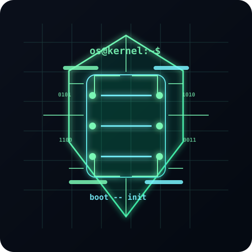

<p align="center">
  
</p>

# OS From Scratch

A hands-on journey into how an operating system is built from the ground up.

<p align="left">
  
  
  
  
</p>

[中文](#中文) | [English](#english)

---

# 中文

## 项目简介

这个项目以“从零开始理解操作系统”为目标，记录我对底层计算机系统的学习与实践。

我从最小的启动代码入手，逐步理解：

- BIOS 与计算机启动流程
- MBR / bootloader / 引导加载器
- x86 实模式与保护模式
- 中断、异常和系统调用基础
- 内存布局与分页机制
- 进程调度与系统抽象层次

这不是一份“为了完成功能而堆代码”的仓库，而是一份真正理解操作系统设计原理的学习记录。

---

## 为什么学 OS

我对这些问题很感兴趣：

- 为什么电脑能启动？
- BIOS 是如何找到启动盘的？
- 为什么 CPU 要从实模式切到保护模式？
- 为什么中断和分页如此重要？
- 操作系统如何把底层硬件抽象成为用户可用的程序环境？

这些问题的答案并不只存在于书本，而是需要从最基础的代码一步步构建出来。这个项目就是一个从最小启动代码出发的实践过程。

---

## 学习路线图

```text
Bootloader
  ↓
Real Mode
  ↓
Protected Mode
  ↓
Interrupts / Exceptions
  ↓
Memory Management
  ↓
Paging / Virtual Memory
  ↓
Processes / Scheduling
  ↓
Drivers / I/O
```

我更关注“每一步都能理解、能调试、能验证”的过程，而不是一开始就盯着庞大的内核代码。

---

## 当前进度

当前项目处于基础引导学习阶段，重点工作包括：

- BIOS 启动流程理解
- MBR 与第一个扇区代码分析
- 实模式和内存布局学习
- 最小 bootloader 设计与实现
- 为后续的保护模式和中断处理打基础

总体状态：正在构建底层基础认知，逐步走向内核和内存管理部分。

---

## 学习入口

- [Roadmap](ROADMAP.md)：全局学习路线
- [Learning Plan](LEARNING_PLAN.md)：分阶段任务清单
- [Learning Journey](docs/LEARNING_JOURNEY.md)：学习日志与记录
- [Project Overview](docs/PROJECT_OVERVIEW.md)：技术概览

---

## 技术栈与方向

- 汇编（x86 / NASM / BIOS）
- 引导程序设计
- 计算机体系结构
- 内存布局与分页
- 中断与异常处理
- 系统编程思维

---

## 系统视图

```text
+---------------------+
| User Programs       |
+---------------------+
          ↓
+---------------------+
| OS Abstractions     |
| Processes / Memory  |
| Files / Drivers      |
+---------------------+
          ↓
+---------------------+
| Kernel / Interrupts |
| Scheduling / MM     |
+---------------------+
          ↓
+---------------------+
| Hardware / CPU / RAM|
+---------------------+
```

这个项目的目标，是从硬件最底层一路建立出“操作系统为什么是这样设计”的理解。

---

## 文档入口

- `README.md`：项目首页
- `ROADMAP.md`：长期学习路线
- `LEARNING_PLAN.md`：阶段任务管理
- `docs/PROJECT_OVERVIEW.md`：技术概览
- `docs/LEARNING_JOURNEY.md`：学习日志
- `docs/README_PERSONAL_JOURNEY.md`：个人学习版说明

---

## 关键价值

这个项目的意义，不只是写出一个能运行的 bootloader，而是：

- 把抽象概念变成真实代码
- 理解系统是如何从硬件走到软件
- 感受汇编、C、链接和调试的结合
- 形成“从底层到上层”的整体认知

---

## 联系方式

- GitHub: https://github.com/Moyeswood
- Email: li228459909@163.com
- Email: lipeter10088001@gmail.com

---

## 结语

我希望这个项目成为一段真实的技术成长记录：

- 从启动代码理解系统结构
- 从汇编理解硬件与计算机基础
- 从实践理解 OS 设计思想

这是一个缓慢但扎实的学习过程，目标不是“快速实现一个完美系统”，而是“真正理解它为什么会这样工作”。

---

# English

## Project Overview

This project is a practical record of learning how an operating system is built from the ground up.

I start from the smallest possible boot code and move step by step through:

- BIOS and machine startup flow
- MBR / bootloader fundamentals
- x86 real mode and protected mode
- interrupts, exceptions, and system call basics
- memory layout and paging
- process scheduling and system abstractions

This is not a repository built to stack features quickly. It is a learning project focused on understanding the architecture and design principles of operating systems.

---

## Why This Project

I am interested in questions like:

- Why does a computer boot when powered on?
- How does BIOS discover the boot device?
- Why does the CPU move from real mode to protected mode?
- Why are interrupts and memory paging so important?
- How does an operating system turn raw hardware into usable software?

The real answers are not only in theory. They become clear when you build the underlying system step by step.

---

## Roadmap

```text
Bootloader
  ↓
Real Mode
  ↓
Protected Mode
  ↓
Interrupts / Exceptions
  ↓
Memory Management
  ↓
Paging / Virtual Memory
  ↓
Processes / Scheduling
  ↓
Drivers / I/O
```

I prioritize understanding and debugging over rushing toward a large kernel.

---

## Current Status

The project is currently in the foundational bootloader stage, focusing on:

- BIOS startup behavior
- MBR and sector loading logic
- real mode memory layout
- minimal bootloader implementation
- preparation for protected mode and interrupt handling

Current status: building the core understanding needed for the next layers of OS design.

---

## Learning Entry Points

- [Roadmap](ROADMAP.md) — full learning route
- [Learning Plan](LEARNING_PLAN.md) — phase-based task list
- [Learning Journey](docs/LEARNING_JOURNEY.md) — notes and progress log
- [Project Overview](docs/PROJECT_OVERVIEW.md) — technical overview

---

## Technical Focus

- x86 Assembly
- Bootloader design
- Computer architecture
- Memory layout and paging
- Interrupts and exception handling
- System programming mindset

---

## System View

```text
+---------------------+
| User Programs       |
+---------------------+
          ↓
+---------------------+
| OS Abstractions     |
| Processes / Memory  |
| Files / Drivers      |
+---------------------+
          ↓
+---------------------+
| Kernel / Interrupts |
| Scheduling / MM     |
+---------------------+
          ↓
+---------------------+
| Hardware / CPU / RAM|
+---------------------+
```

The purpose of this project is to understand how an operating system is built from the hardware layer up.

---

## Documentation

- `README.md` — project homepage
- `ROADMAP.md` — full learning roadmap
- `LEARNING_PLAN.md` — concrete task plan
- `docs/PROJECT_OVERVIEW.md` — technical overview
- `docs/LEARNING_JOURNEY.md` — learning log
- `docs/README_PERSONAL_JOURNEY.md` — personal journey notes

---

## Why It Matters

This project is valuable because it translates theory into executable understanding:

- abstract concepts become real code
- hardware and software are connected in practice
- assembly, C, linking, and debugging become part of one learning process
- system programming becomes intuitive rather than theoretical

---

## Contact

- GitHub: https://github.com/Moyeswood
- Email: li228459909@163.com
- Email: lipeter10088001@gmail.com

---

## Closing

I want this repository to serve as a genuine technical growth log:

- understanding system structure from the boot process
- understanding OS design through low-level code
- building practical knowledge of system programming

This is a deliberate, slow, and meaningful path. The goal is clarity, not speed.

---

<p align="center">
  <sub>Built from curiosity, refined through code, and documented step by step.</sub>
</p>
