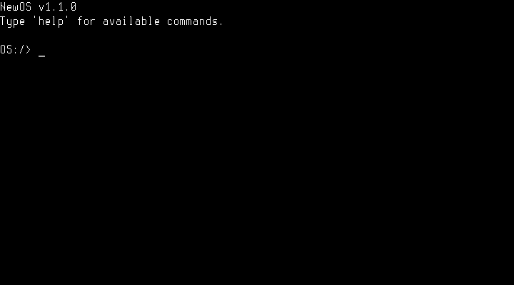
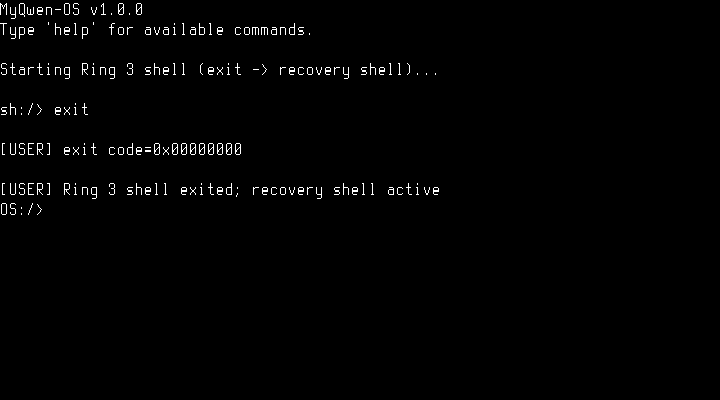
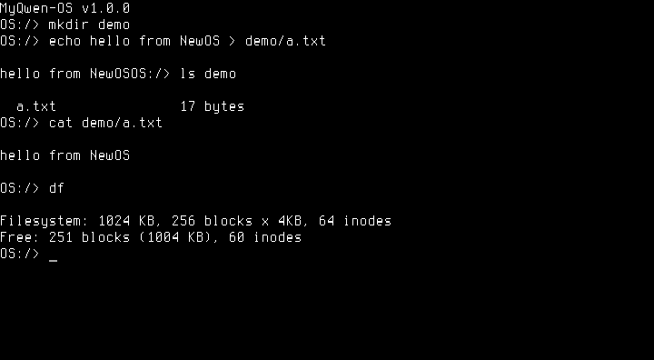
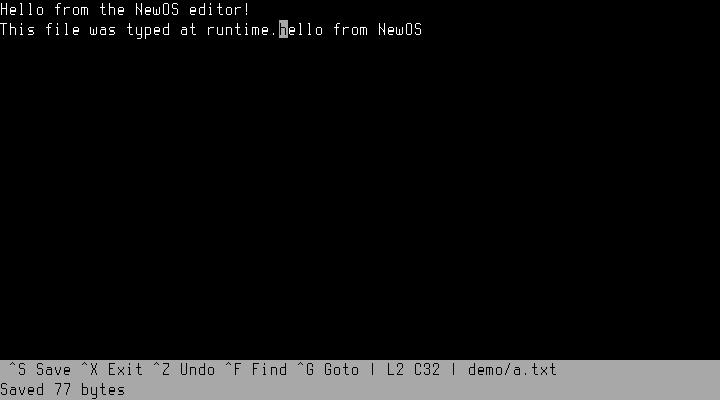
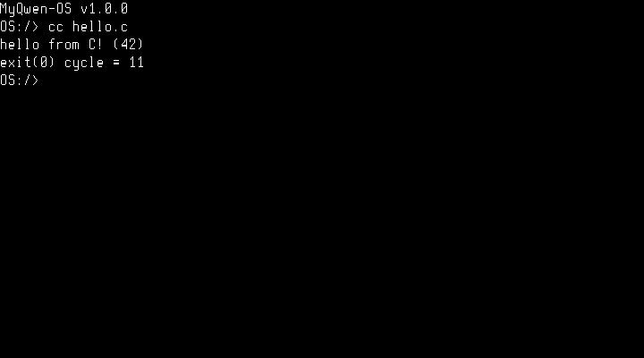
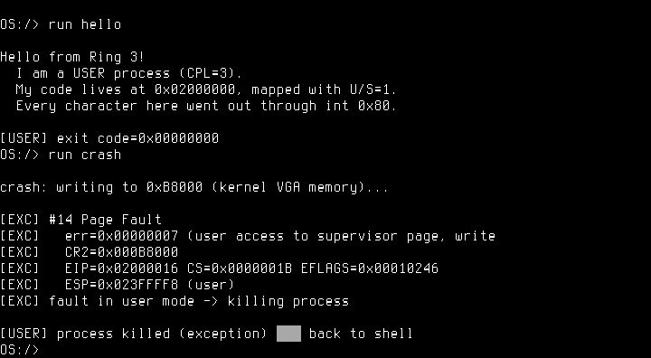
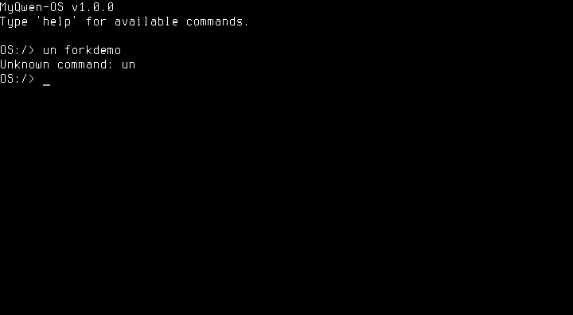
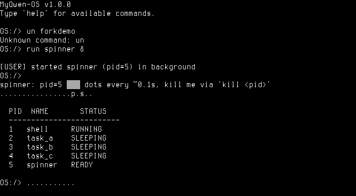

# 🚀 NewOS

<p align="center">
  <em>一个从零开始、手写的 32 位 x86 教学操作系统</em><br>
  <em>从 512 字节引导扇区，到在自制 OS 中编辑、编译、调试和运行程序</em>
</p>

<p align="center">
  <a href="README.en.md">English</a> · 中文主文档
</p>

<p align="center">
  
  
  
  
</p>

<p align="center">
  
</p>

NewOS 是一个以学习和可读性为优先的 32 位 x86 操作系统。它使用 C 和少量
x86 汇编实现，在 QEMU 中完成引导、保护模式、分页、进程、文件系统、
Ring 3 用户态、Shell、编辑器和调试器，并最终支持在操作系统内部编写和运行
程序。

当前稳定进度为 **里程碑 33**。完整 `make test-suite` 已通过，包含内存、
文件系统、磁盘持久化、进程、ELF、Shell、编辑器、C 编译器、汇编器、调试器、
抢占调度和游戏回归。

> 这是教学项目，不是生产操作系统。设计重点是理解机制、验证行为和保持代码
> 可读性；安全边界、性能和 POSIX 完整度都不是目前的主要目标。

## 目录

- [项目特点](#项目特点)
- [快速开始](#快速开始)
- [两套 Shell](#两套-shell)
- [启动流程](#启动流程)
- [系统架构](#系统架构)
- [Ring 3 用户 Shell](#ring-3-用户-shell)
- [内核恢复 Shell](#内核恢复-shell)
- [C 编译器](#c-编译器)
- [汇编器与调试器](#汇编器与-debug-monitor)
- [编辑器和应用](#编辑器和应用)
- [文件系统](#文件系统)
- [系统调用 ABI](#系统调用-abi)
- [典型工作流](#典型工作流)
- [自动化测试](#自动化测试)
- [目录结构](#目录结构)
- [已知限制](#已知限制)
- [常见问题](#常见问题)
- [源码逐文件文档](#源码逐文件文档)
- [开发记录](#开发记录)
- [项目历程](#项目历程)

## 项目特点

### 从硬件开始

- 512 字节手写引导扇区。
- BIOS E820 内存地图解析。
- A20 开启和 32 位保护模式切换。
- GDT、TSS、IDT、8259A PIC 和中断门。
- 实模式往返跳板，可临时调用 BIOS 切换 VGA 图形模式。

### 内存与进程

- 物理页分配器、保留区位图、页引用计数。
- 内核堆 `kmalloc/kfree/krealloc`，带分裂、合并和完整性检查。
- 32MB 恒等映射分页。
- 每个用户进程拥有独立页目录和页表。
- 按需补零页、fork COW、栈 guard page、`brk` 和匿名 `mmap`。
- PCB 轮转调度、PIT 抢占、睡眠队列和僵尸进程回收。

### 文件与设备

- ATA PIO、LBA28 主盘访问。
- 1MB 教学文件系统，4KB 块，64 个 inode。
- 12 个直接块和一级间接块。
- 延迟回写、可睡眠 FS mutex、元数据 redo journal 和断电重放。
- `rename` 覆盖、硬链接、截断和完整目录路径解析。
- VGA 文本/图形、PS/2 键盘、COM1 串口、PIT 和 PC 扬声器。

### 用户态

- Ring 3 代码/数据段。
- TSS 自动切换每进程内核栈。
- `int 0x80` 系统调用门。
- 37 个系统调用编号。
- 负 errno 内核 ABI 和用户态 `errno` 兼容层。
- flat 和 ELF32 可执行文件加载。
- `fork`、`execve`、`waitpid`、管道、dup、信号和作业控制。

### 开发工具

- nano 风格 `edit`。
- vi 风格 `vi`。
- c4 迷你 C 编译器 `cc`。
- 两遍扫描 32 位汇编器 `asm`。
- 带真实寄存器、TF/#DB 单步和 INT3 断点的 `debug` Monitor。

## 快速开始

### 环境要求

当前主要在 Arch Linux 上开发和测试，需要：

- `nasm`
- 支持 32 位目标的 `gcc`
- `ld`
- `objcopy`
- `qemu-system-i386`
- Python 3，用于自动化测试

检查工具链：

```bash
gcc -m32 -v
nasm -v
ld -v
qemu-system-i386 --version
python3 --version
```

如果 `gcc -m32` 无法链接，需要安装发行版的 32 位开发库。

### 构建和运行

```bash
make -j4
make run
```

生成文件：

| 文件 | 用途 |
|---|---|
| `build/os.img` | 默认镜像，启动 Ring 3 用户 Shell |
| `build/os-kernel.img` | 恢复/测试镜像，直接启动内核 Shell |
| `build/kernel.bin` | 原始内核二进制 |
| `build/kernel.elf` | 带符号的内核 ELF |
| `build/disk.img` | 2MB ATA 持久化磁盘 |
| `build/sh.bin` | Ring 3 Shell 的 flat 镜像 |

`build/disk.img` 不会被 `make` 自动清空。文件系统中的文件可以跨 QEMU
重启保留。执行 `make clean` 才会删除整个 `build/`。

### 默认启动

`make run` 启动 `build/os.img`：

```text
sh:/>
```

这是 Ring 3 用户 Shell。

### 直接进入恢复 Shell

首次使用时先确保磁盘镜像存在：

```bash
make build/disk.img
```

```bash
qemu-system-i386 -fda build/os-kernel.img \
  -drive file=build/disk.img,format=raw,if=ide,index=0 \
  -serial stdio
```

启动后进入：

```text
OS:/>
```

恢复 Shell 拥有 `cc`、`edit`、`vi`、`asm`、`debug`、`tetris` 和
`mario` 等内核工具。

### GDB 调试

```bash
make debug
```

QEMU 会监听 GDB 端口 `1234` 并在启动时暂停。

## 两套 Shell

NewOS 故意保留两套 Shell，它们不是重复实现，而是特权级边界两侧的不同接口。

| 对比项 | `sh:/>` | `OS:/>` |
|---|---|---|
| 运行级别 | Ring 3 用户态 | Ring 0 内核态 |
| 入口 | `build/os.img` 默认 | `build/os-kernel.img` 或用户 Shell 退出后 |
| 实现 | `user/sh.c` | `kernel/shell.c` |
| 地址空间 | 独立用户进程 | 内核线程/内核上下文 |
| 文件操作 | 通过系统调用 | 直接调用 FS |
| 崩溃影响 | 杀死 Shell 进程，返回恢复 Shell | 可能导致内核 panic |
| 作业控制 | `jobs/fg/bg`、管道、Ctrl+C/Z | 简化内核任务命令 |
| 内核工具 | 不可直接使用 | `cc/edit/vi/asm/debug/font` |
| 游戏 | 不可直接使用 | `tetris/mario` |

### 用户 Shell 进入恢复 Shell

```text
sh:/> exit
```

`exit` 只结束 Ring 3 Shell 进程，不关闭 QEMU。正常或异常退出后，内核会重新
唤醒恢复 Shell：

```text
OS:/>
```

### 恢复 Shell 返回用户 Shell

```text
OS:/> run sh
```

重新启动 Ring 3 Shell 进程。

### 为什么游戏和编译器不在 `sh:/>`

`cc` 使用内核虚拟机和内核内存池，`debug` 操作页表、异常和任务状态，
`edit/vi` 直接操作 VGA 文本缓冲，`tetris/mario` 需要切换 VGA 模式并读取
硬件键盘。它们目前没有通过受控系统调用暴露给 Ring 3。

## 启动流程

典型启动过程：

```text
BIOS
  → 读取磁盘第一个扇区
  → boot/boot.asm
  → 开启 A20，加载 GDT
  → 进入 32 位保护模式
  → 加载 kernel.bin 到低地址
  → kernel/entry.asm
  → kernel_main()
     → E820 和物理内存
     → 分页和内核堆
     → GDT/TSS/IDT/PIC/PIT
     → 调度器
     → VGA 字体和文件系统
     → 用户程序表与 /bin 发布
     → 开机画面
     → sh:/>  或  OS:/>
```

引导扇区最多加载 896 个扇区，即 448KB。内核 ELF 中的普通 BSS 不写入磁盘
镜像；链接脚本将 BSS 放到普通 RAM 的 `0x00200000`，避免进入
`0x000A0000–0x000FFFFF` 的 VGA/BIOS 保留区域。

启动模式字节位于镜像偏移 `0x1FD`：

| 值 | 行为 |
|---|---|
| `1` | 自动启动 Ring 3 Shell |
| `0` | 直接启动内核恢复 Shell |

`build/os-kernel.img` 由 `build/os.img` 复制后将此字节清零生成。

## 系统架构

### 物理内存

| 区域 | 用途 |
|---|---|
| `0x00000000–0x000FFFFF` | 传统低内存、VGA/BIOS 保留区 |
| `0x00100000` 起 | 可管理物理页、位图 |
| `0x01000000` | 内核页目录和页表预留区 |
| `0x00200000` | 内核 BSS |

当前恒等映射上限为 32MB。物理页分配器只从 `0x00100000` 以上的可用 E820
区域分配，并保留内核镜像、位图和页表。

### 用户虚拟地址空间

| 范围 | 用途 |
|---|---|
| `0x02000000–0x02040000` | 可执行镜像 |
| `0x02040000–0x020C0000` | `brk` 堆 |
| `0x020C0000–0x022F0000` | 匿名 `mmap` |
| `0x022F0000` | 栈 guard page |
| `0x022F1000–0x02400000` | 用户栈 |

每个进程只创建实际触及的用户物理页。首次访问堆、mmap 和栈页时由 #PF 补零。
fork 初始共享物理页并标记 COW，用户写共享页时才复制。

### 任务与进程

- 最多 16 个任务槽。
- 每个用户进程拥有独立页目录、内核栈和 fd 表。
- 每个 fd 表有 16 项。
- 最多四段管道。
- `TASK_READY/RUNNING/SLEEPING/STOPPED/ZOMBIE` 状态机。
- 子进程退出后由父进程 `waitpid` 收尸，孤儿僵尸由后续 spawn 清扫。

## Ring 3 用户 Shell

默认用户 Shell 支持：

- 单/双引号和反斜杠转义。
- `$VAR`、`$?`、`$$`。
- `*`、`?` 通配符和字段拆分。
- `$(...)` 命令替换，支持嵌套和多行。
- 未闭合引号、命令替换和结尾反斜杠的多行续行。
- `;` 顺序命令。
- `<`、`>`、`>>`、`2>`、`2>>`、`2>&1`。
- 最多四段管道。
- 后台 `&`、进程组和 Ctrl+C/Ctrl+Z。
- 行内光标编辑、Home/End/Delete。
- 上下键历史、Ctrl+R 搜索和 Tab 补全。
- `/.sh_history` 持久化历史。
- 16 项 Shell 环境变量。

### 内置与工具命令

Shell 状态：

| 命令 | 说明 |
|---|---|
| `help` | 显示命令类别 |
| `cd [dir]` | 切换目录；无参数回根目录 |
| `cd -` | 返回并打印上一条目录 |
| `exit [N]` | 退出 Ring 3 Shell 并进入恢复 Shell |
| `history [N]` | 显示最近历史 |
| `history -c` | 清空历史文件 |
| `export NAME` / `unset NAME` | 管理环境变量 |
| `set` / `env` | 显示全部变量 / 导出变量 |
| `true` / `false` | 固定返回 0 / 1 |
| `read NAME` | 从键盘或 `< file` 读取变量 |
| `source FILE` / `. FILE` | 在当前 Shell 执行脚本 |
| `which NAME` / `type NAME` | 查询内置命令或 `/bin` 程序 |

文件和文本：

| 命令 | 说明 |
|---|---|
| `echo [text]` | 输出文本，支持重定向 |
| `pwd` | 当前目录 |
| `ls [-la] [path]` | 简洁或长格式列目录 |
| `cat [file...]` | 输出文件 |
| `touch file...` | 创建空文件 |
| `cp [-r] src dest` | 复制文件或目录 |
| `mkdir [-p] dir...` | 创建目录 |
| `rm [-rf] path...` | 删除文件或目录 |
| `mv old new` | 移动/重命名 |
| `ln old new` | 创建普通文件硬链接 |
| `truncate file N` | 设置文件字节长度 |
| `stat path` | inode、类型、大小和链接数 |
| `head [-n N] [file...]` | 文件开头，默认 10 行 |
| `tail [-n N] [file...]` | 文件结尾，默认 10 行 |
| `wc [-lwc] [file...]` | 行数、单词数和字节数 |
| `grep [-in] pattern [file...]` | 固定字符串过滤 |
| `hexdump [file...]` | 十六进制和 ASCII 查看 |

格式化和其他命令：

| 命令 | 说明 |
|---|---|
| `printf FORMAT [args...]` | `%s/%d/%u/%x/%c/%%` 格式化 |
| `test EXPR` / `[ EXPR ]` | 文件、字符串和整数测试 |
| `clear` | 清屏 |
| `sleep N` | 按 PIT 滴答近似睡眠 N 秒 |
| `uptime` | 显示启动时长 |
| `jobs` | 显示作业 |
| `fg %N` / `bg %N` | 前台/后台恢复作业 |
| `kill PID` / `kill %N` | 发送信号 |
| `wait` | 等待作业 |

### 文本工具示例

```text
cp /etc/readme.txt /backup.txt
cat /backup.txt | grep -n "NewOS"
head -n 5 /backup.txt
tail -n 3 /backup.txt
wc -lwc /backup.txt
```

### 脚本示例

```sh
NAME=NewOS
echo "hello $NAME"
printf 'count=%d\n' 42

read ANSWER < /answer.txt
echo "answer=$ANSWER"
```

已支持 `&&`、`||`、`!`、括号分组、`if/elif/else/fi`、`while`、`for`、`case`
以及循环中的 `break` / `continue`。`while` 和 `for` 都支持循环级输入重定向：

```sh
echo first > /lines.txt
echo second >> /lines.txt
INPUT=/lines.txt
while read LINE; do echo "line=$LINE"; done < "$INPUT"
for LABEL in a b; do read LINE; echo "$LABEL=$LINE"; done < /lines.txt
```

输入文件只在进入循环时打开一次，迭代间共享读取偏移；循环退出后恢复原 stdin。
文件不存在时报告错误并返回非零状态，支持 `||` 错误分支。

```sh
case "$MODE" in
  dev|staging) echo build;;
  prod)        echo release;;
  *)           echo unknown;;
esac
```

`case` 支持 `|` 多模式与 `*`/`?` glob 匹配（不做文件名展开）；尚未实现函数
和 positional parameters；更多设计与限制见
[`docs/MILESTONE_34_SHELL_CONTROL_FLOW.md`](docs/MILESTONE_34_SHELL_CONTROL_FLOW.md)。

### `/bin` 中的用户程序

构建时嵌入 23 个 flat 用户程序和 1 个 ELF32 演示程序：

```text
hello count crash div0 echodemo badptr forkdemo spinner
vmtest vmguard execdemo execbad waittest execargv
memdemo allocdemo filedemo fdstdin sh fdpipe fscheck
sigtest errtest elfdemo
```

这些程序用于用户态、进程、VM、文件系统、信号和错误码回归验证。用户 Shell
也会将同一份 Shell 镜像发布为 `/bin/echo`、`cat`、`ls`、`pwd`、`mkdir`、
`rm`、`mv` 和 `stat` 工具入口。

## 内核恢复 Shell

恢复 Shell 直接运行在内核态，提供系统诊断和维护工具。

### 基础与诊断

| 命令 | 说明 |
|---|---|
| `help` | 命令列表 |
| `clear` | 清屏 |
| `version` | 版本 |
| `date` | CMOS 实时时钟 |
| `reboot` | 重启 |
| `meminfo` | 物理页统计 |
| `memmap` | E820 内存地图 |
| `heap [blocks]` | 内核堆状态和完整性 |
| `heaptest` | 内核堆压力测试 |
| `ps` | 任务表 |
| `start` / `stop` | 启停 A/B/C 抢占演示 |

### 文件与开发工具

| 命令 | 说明 |
|---|---|
| `pwd/ls/cd/mkdir/touch/cat/rm/mv/ln/truncate/stat/df/sync` | 内核文件系统操作 |
| `edit FILE` | nano 风格编辑器 |
| `vi FILE` | vi 风格编辑器 |
| `cc FILE.c [args...]` | 编译并运行迷你 C |
| `asm SRC -o DEST` | 汇编 flat 用户程序 |
| `debug FILE` | 调试真实暂停用户进程 |
| `font` | 字体和字号 |
| `tetris` / `mario` | 游戏 |
| `testmode` | VGA 图形模式往返测试 |
| `splash` | 重放开机画面 |
| `run PROG [args] [&]` | 启动内置或 `/bin` 程序 |
| `run sh` | 重新进入 Ring 3 Shell |

`fscrash` 是日志断电注入测试入口，普通使用通常不需要。

## C 编译器

`cc` 基于 Robert Swierczek 的 **c4: C in four functions** 移植。它不是
原生代码编译器，而是：

```text
C 源码
  → 词法/语法分析
  → 内部字节码
  → 内核栈式虚拟机执行
```

它不会生成独立 ELF，也不参与系统链接。

### 支持范围

- 类型：`char`、`int`、多级指针、`enum`。
- 全局/局部变量和声明初始化。
- 算术、取模、移位、位运算、比较、逻辑运算和三元表达式。
- 前置/后置 `++`、`--`。
- `&`、`*`、指针加减和 `ptr[i]`。
- 类型转换和 `sizeof(int/char/pointer)`。
- `if/else`、`while`、`do/while`、`for`。
- `break`、`continue`、`return`。
- 自定义函数、参数、递归。
- `int main(argc, argv)`。
- 十进制、十六进制和八进制整数。
- 字符、字符串和 `//` 行注释。

### 内建运行时

```text
printf malloc free memset memcmp
open read close
exit
```

- `printf` 支持 `%d/%s/%c/%%`，数字支持宽度和零填充。
- `open/read/close` 可读取 OS 内已有文件。
- `malloc` 是 64KB bump 堆。
- `free` 当前为空操作。
- 文件写入、截断和 seek 尚未作为 cc 内建函数开放。

### 示例

```c
int fact(int n) {
    if (n < 2) return 1;
    return n * fact(n - 1);
}

int main() {
    int i;
    int sum = 0;
    for (i = 1; i <= 5; i = i + 1) {
        sum = sum + i;
    }
    printf("sum=%d fact=%d\n", sum, fact(5));
    return 0;
}
```

### 当前限制

- 不支持 `struct/union/typedef`。
- 不支持 `float/double`。
- 不支持 `unsigned/short/long`。
- 不支持 `switch/case`、`goto`。
- 不支持 `/* ... */` 块注释。
- 不支持宏和真正的预处理器；`#` 开头的行会被跳过。
- 不支持真正的 `int a[N]` 数组声明；可用 `ptr[i]` 模拟一维数组。
- 局部声明位于函数开头，暂不支持语句块中的新声明。
- 不支持 `for (int i = ...)`。
- 不支持函数原型、前置声明和跨文件链接。
- 不支持 `+=`、`-=` 等复合赋值。
- 源文件约 16KB 上限。
- 符号、代码、数据、栈和堆各使用一个 64KB 运行时池。
- 无限循环可按 ESC 中断。

## 汇编器与 DEBUG Monitor

### `asm`

```text
asm source.asm -o /bin/program
```

两遍扫描生成入口为 `0x02000000` 的 flat Ring 3 程序。

支持：

- `mov/lea`
- `add/or/and/sub/xor/cmp/test`
- `inc/dec/not/neg/mul/div`
- `shl/shr`
- `push/pop`
- `jmp/call/ret`
- 条件分支
- `int`、`nop/hlt`
- 标签、`db/dd`
- 立即数、寄存器、绝对地址和 `[reg+disp]`

生成后可直接运行：

```text
run /bin/program
```

### `debug`

```text
debug /bin/program
```

调试目标是一个真实的 STOPPED Ring 3 进程。

| 命令 | 说明 |
|---|---|
| `r` | 真实 GPR/EIP/EFLAGS/ESP/CR2/CR3 |
| `t [addr]` | TF/#DB 单步 |
| `p` | call step-over |
| `g [addr]` | 从当前现场继续 |
| `bp [addr]` | 持久 INT3 断点 |
| `bl` / `bc` | 列出/清除断点 |
| `d [addr]` | 内存转储 |
| `u [addr]` | 反汇编 |
| `e addr bytes` | 修改镜像和目标内存 |
| `w` | 写回镜像文件 |
| `q` | 退出并回收目标进程 |

断点命中后会恢复原指令字节，继续时通过 TF 隐式单步并自动重装 INT3。

## 编辑器和应用

### nano 风格 `edit`

- 方向键、Home/End、PgUp/PgDn。
- Ctrl+方向键按词移动。
- Ctrl+Backspace 按词删除。
- Ctrl+Z/Ctrl+Y 撤销/重做。
- Ctrl+F 搜索、Ctrl+G 跳行。
- Ctrl+S 保存、Ctrl+X 退出。
- 未保存退出时选择保存、丢弃或取消。

### vi 风格 `vi`

- Normal/Insert/Command 模式。
- `i/a/o`、Esc。
- `h/j/k/l`、`0/$`、`w/b`。
- `x/dd/yy/p/dw/d$`。
- `/`、`n`、`u`、Ctrl+R。
- `:w`、`:q`、`:q!`、`:wq`、`:x`。

### 字体

```text
font 20
font terminus 18
font goha 16
font list
```

支持 8–32px 高度和多种 8 像素宽位图字体。图形模式返回文本模式后会重新应用
当前字体和字号。

### 游戏

```text
tetris
mario
```

游戏运行在 VGA 模式 13h，按 ESC 返回文本模式。

## 文件系统

NewOS 文件系统是 xv6 风格教学实现。

- 独立 `build/disk.img`，2MB ATA 磁盘。
- 文件系统从 LBA 2048 开始。
- 文件系统容量 1MB，256 个 4KB 块。
- 64 个 inode。
- 超级块、inode 位图、块位图。
- inode 含 12 个直接块和 1 个一级间接块。
- 目录项链式存储，包含真实 `.` 和 `..`。
- 文件 close、`sync` 和重启触发持久化。
- 4KB 脏块缓存，有界延迟回写。
- 元数据 redo journal。
- 已提交日志在启动时重放。
- 支持硬链接、truncate、rename 覆盖和目录移动。

没有磁盘时提供易失文件系统回退。

### 持久化

```bash
make run
# 在 OS 中创建文件
# 退出 QEMU
make run
```

只要不删除 `build/disk.img`，文件就会保留。

## 系统调用 ABI

用户态通过软件中断 `int 0x80` 进入内核。

寄存器约定：

```text
eax = 系统调用号
ebx = 参数 1
ecx = 参数 2
edx = 参数 3
eax = 返回值
```

内核错误返回负 errno。用户库将其转换为：

```c
return -1;
errno = error_code;
```

系统调用编号：

| 编号 | 名称 |
|---:|---|
| 0 | `exit` |
| 1 | `putc` |
| 2 | `puts` |
| 3 | `getkey` |
| 4 | `getticks` |
| 5 | `fork` |
| 6 | `getpid` |
| 7 | `sleep` |
| 8 | `brk` |
| 9 | `mmap` |
| 10 | `execve` |
| 11 | `waitpid` |
| 12–16 | `open/read/write/close/lseek` |
| 17–19 | `chdir/getcwd/mkdir` |
| 20–24 | `pipe/dup/dup2/remove/readdir` |
| 25–27 | `setpgid/tcsetpgrp/kill` |
| 28–31 | `rename/stat/link/truncate` |
| 32–35 | signal action/mask/return/flags |
| 36 | `clear` |

## 典型工作流

### 1. 在用户 Shell 中管理文件

```text
sh:/> mkdir -p /work/test
sh:/> cd /work/test
sh:/work/test> echo hello > note.txt
sh:/work/test> cp note.txt backup.txt
sh:/work/test> grep -n hello *.txt
sh:/work/test> wc -l note.txt
```

### 2. 编写和运行 C

```text
sh:/> exit
OS:/> edit /hello.c
OS:/> cc /hello.c
hello from C! (42)
```

或使用 vi：

```text
OS:/> vi /hello.c
OS:/> cc /hello.c
```

### 3. 汇编和运行程序

```text
OS:/> edit /hello.asm
OS:/> asm /hello.asm -o /bin/helloasm
OS:/> run /bin/helloasm
```

### 4. 调试程序

```text
OS:/> debug /bin/helloasm
- bp 0x02000005
- g
- r
- t
- g
- q
```

### 5. 返回用户 Shell

```text
OS:/> run sh
```

## 自动化测试

项目包含 24 个 Python 无头测试脚本；附着式测试内部再运行 preempt 和 Mario，
合计覆盖 25 套测试。测试通过 QEMU monitor 注入键盘输入，并读取 COM1 串口和
部分 VGA 文本结果。

运行完整测试：

```bash
make test-suite
```

常用单项测试：

```bash
make test-memory
make test-fs2
make test-fs-journal
make test-boot-shell
make test-vi
make test-asm
make test-shell
make test-fd
```

### 测试覆盖

| 测试 | 覆盖范围 |
|---|---|
| `test-memory` | E820、页分配和内核堆，15 项 |
| `test-splash` | 开机画面，14 项 |
| `test-font` | 字体与字号，30 项 |
| `test-fs` | 文件和目录基础操作，43 项 |
| `test-disk` | ATA、挂载和跨重启持久化，19 项 |
| `test-fs2` | 间接块、rename、硬链接、truncate 和并发写 |
| `test-fs-journal` | 日志提交和断电重放 |
| `test-signals` | handler、mask、pending、sigreturn，17 项 |
| `test-boot-shell` | 两种启动模式及恢复工具入口 |
| `test-edit` | nano 编辑器，67 项 |
| `test-vi` | vi 模式与行操作，28 项 |
| `test-asm` | 汇编器和 DEBUG，34 项 |
| `test-cc` | C 编译器，41 项 |
| attached tests | 抢占调度和 Mario 界面 |
| `test-user` | Ring 3 基础行为，36 项 |
| `test-sched` | PCB 调度与键盘，15 项 |
| `test-proc` | fork、后台和 kill，36 项 |
| `test-memproc` | 用户堆、fork 隔离和 waitpid，26 项 |
| `test-alloc` | 空闲链表和 realloc，24 项 |
| `test-vm` | 按需分页、COW、guard、brk/mmap，22 项 |
| `test-exec` | flat/ELF 加载与回滚，26 项 |
| `test-process` | waitpid、argv/envp、ELF32，39 项 |
| `test-fd` | fd、CWD、pipe、dup2、errno，63 项 |
| `test-shell` | Shell、实用工具、脚本和作业，224 项 |

附着式测试需要等待 QEMU 开机完成：

```bash
python3 tools/run-attached-tests.py
```

## 目录结构

```text
.
├── boot/
│   └── boot.asm              # 512B 引导扇区
├── kernel/
│   ├── kernel.c              # 内核初始化入口
│   ├── memory.c              # E820、物理页和引用计数
│   ├── heap.c                # 内核堆
│   ├── paging.c              # 页表和地址空间原语
│   ├── vm.c                  # 按需分页、COW、brk/mmap、ELF
│   ├── proc.c                # 进程、fork、waitpid 和信号
│   ├── task.c                # PCB 调度器
│   ├── switch.asm            # 上下文切换
│   ├── user.c                # int 0x80 分发
│   ├── user_asm.asm          # Ring 3 syscall 入口
│   ├── fs.c                  # 文件系统、缓存、日志
│   ├── fd.c                  # fd、pipe 和共享打开对象
│   ├── exec.c                # /bin 发布和 exec 加载
│   ├── editor.c              # nano/vi
│   ├── cc.c                  # c4 C 编译器
│   ├── assembler.c           # 32 位 flat 汇编器
│   ├── debugger.c            # 真实单步和断点
│   ├── shell.c               # 内核恢复 Shell
│   ├── ata.c                 # ATA PIO
│   ├── keyboard.c            # PS/2 键盘
│   ├── timer.c               # PIT
│   ├── vga.c                 # VGA 文本
│   ├── graphics.c            # 模式 13h
│   ├── font.c                # 字体管理
│   ├── tetris.c              # 俄罗斯方块
│   ├── mario.c               # 超级马里奥
│   └── linker.ld             # 内核 BSS 布局
├── user/
│   ├── lib.h                 # 用户 syscall 包装
│   ├── sh.c                  # Ring 3 Shell
│   ├── linker.ld             # flat 用户镜像布局
│   └── *.c                   # 用户态程序和演示
├── tools/
│   ├── test-*.py             # 无头回归测试
│   └── run-attached-tests.py # 附着式测试
├── docs/
│   ├── MILESTONE_*.md        # 里程碑设计记录
│   └── source/               # 逐文件源码解析文档
├── note/
│   ├── *.md                  # 开发踩坑记录
│   └── *.png                 # 运行截图
├── assets/
├── Makefile
├── ROADMAP.md
├── LEARNING_PLAN.md
└── README.md
```

`smallOS/` 保留了早期最小内核版本，主要用于对照学习，不是当前主构建目标。

## 已知限制

### 用户态和进程

- 不支持动态链接、PT_INTERP、PIE/ET_DYN。
- 最多 16 个任务槽。
- argv 上限 16，envp 上限 8，参数文本约 3KB。
- 最多四段管道。
- pipe 缓冲区 1KB。
- 文件系统锁等待暂不返回 EINTR。
- errno 是 Shell/程序内的静态值，不是完整线程局部存储。

### Shell

- 已有 `if/elif/else`、`while`、`for`、`case`；无函数。
- 没有函数、positional parameters、alias 和完整 POSIX 展开规则。
- `grep` 不支持正则表达式。
- `test` 不支持完整 `-a/-o` 优先级。
- `printf` 不支持完整宽度、精度、`*` 和格式复用。
- 命令替换的非零退出状态尚未完整传播。
- Shell 环境不跨 Shell 重启持久化。

### 文件系统

- 只有 1MB 文件系统空间。
- 没有时间戳、权限位、用户/组。
- 没有二级间接块。
- 日志保护元数据原子性；未回写文件数据仍可能在模拟断电时丢失。
- ATA 只支持 primary master、polling PIO 和 LBA28。
- 没有通用 mount 和分区表。

### 调试器

- `p` 只识别直接 `call rel32`。
- 最多 8 个软件断点。
- 暂无硬件断点。
- 暂无 `a addr` 交互式汇编和寄存器写。
- 反汇编是面向当前汇编器子集的教学实现。

### C 编译器

- 只支持单文件 C 子集。
- 不兼容标准 C 头文件和链接流程。
- 不生成原生机器码或 ELF。
- 堆 `free` 为空操作。
- 只提供文件读取，没有完整文件写 API。

## 常见问题

### 为什么 `cc/edit/vi/asm/debug/tetris/mario` 在 `sh:/>` 中不存在？

它们属于内核恢复 Shell，不是 Ring 3 用户 Shell。

```text
sh:/> exit
OS:/> help
```

### 如何直接启动恢复 Shell？

```bash
qemu-system-i386 -fda build/os-kernel.img \
  -drive file=build/disk.img,format=raw,if=ide,index=0 \
  -serial stdio
```

### QEMU 提示镜像被占用

通常表示另一个 QEMU 仍在运行并打开了 `build/os.img`。关闭旧 QEMU 后重新执行：

```bash
make run
```

使用 `-snapshot` 的只读测试映像不会主动写回磁盘。

### 构建时报 32 位工具链错误

确认 `gcc -m32` 可用，并确认 `nasm`、`ld`、`objcopy` 已安装。

### 文件重启后消失

检查是否启动时带入了持久化磁盘：

```bash
-drive file=build/disk.img,format=raw,if=ide,index=0
```

不带 ATA 盘时内核使用易失回退文件系统。

### `cc` 找不到 `stdio.h`

`cc` 没有预处理器和标准库头文件。`printf`、`malloc`、`open`、`read` 等名称
已经内置，直接使用即可，不要写 `#include`。

### 程序源码过大

`cc` 源文件上限约 16KB。可以拆分逻辑，但目前没有跨文件链接。

## 源码逐文件文档

完整源码解析集中在 [`docs/source/`](docs/source/README.md)，当前包含 184 份
Markdown 文档，覆盖 33,744 行源码。每份文档包含文件职责、关键符号、易错点
以及源文件逐行解析。

重新生成：

```bash
make docs
```

## 开发记录

关键设计文档：

- [文档索引与当前状态](docs/NEXT_SESSION.md)
- [虚拟内存](docs/MILESTONE_13_VM.md)
- [exec 与文件加载](docs/MILESTONE_14_EXEC.md)
- [进程、ELF 与 waitpid](docs/MILESTONE_15_PROCESS_ELF.md)
- [用户 Shell](docs/MILESTONE_20_USER_SHELL.md)
- [作业控制](docs/MILESTONE_21_JOBS.md)
- [停止与恢复](docs/MILESTONE_22_STOP_RESUME.md)
- [磁盘文件系统](docs/MILESTONE_23_DISK_FS.md)
- [文件系统 V2](docs/MILESTONE_24_FS_V2.md)
- [崩溃一致性](docs/MILESTONE_25_CRASH_CONSISTENCY.md)
- [用户态信号](docs/MILESTONE_26_SIGNALS.md)
- [Shell 2.0](docs/MILESTONE_27_SHELL_V2.md)
- [Shell 3.0](docs/MILESTONE_28_SHELL_V3.md)
- [errno 与脚本状态](docs/MILESTONE_29_ERRORS.md)
- [vi 编辑器](docs/MILESTONE_30_VI.md)
- [汇编器与 DEBUG](docs/MILESTONE_31_ASSEMBLY_DEBUG.md)
- [真实单步与断点](docs/MILESTONE_32_REAL_DEBUG.md)
- [实用 Shell 命令](docs/MILESTONE_33_SHELL_UTILITIES.md)

更多开发踩坑记录和截图位于 [`note/`](note/)。

## 项目历程

| 里程碑 | 内容 |
|---:|---|
| 1 | 实模式往返、BIOS 调用和图形模式 |
| 2 | 俄罗斯方块 C 移植 |
| 3 | PIT IRQ0 抢占式多任务 |
| 4 | 超级马里奥 |
| 5 | VGA 字体和字号 |
| 6 | 内存文件系统和文件命令 |
| 7 | nano 风格编辑器 |
| 8 | c4 迷你 C 编译器 |
| 9 | 32 位开机画面 |
| 10 | Ring 3、TSS、用户页表、系统调用和异常 |
| 11 | PCB 调度、fork、每进程地址空间和后台进程 |
| 12 | E820、内核堆和内存诊断 |
| 13 | 按需分页、COW、guard、brk/mmap |
| 14 | `/bin`、flat 加载和事务式 exec |
| 15 | waitpid、argv/envp、ELF32 |
| 16 | 用户 allocator |
| 17 | 编辑器增强 |
| 18 | 马里奥增强 |
| 19 | fd 表、CWD、文件 API |
| 20 | 用户 Shell、管道、重定向和共享打开对象 |
| 21 | 四段管道、进程组和 Ctrl+C |
| 22 | SIGSTOP/SIGCONT、Ctrl+Z 和 bg |
| 23 | ATA、磁盘文件系统和持久化 |
| 24 | 一级间接块、rename、stat 和并发写 |
| 25 | FS mutex、延迟回写、redo journal、硬链接 |
| 26 | 用户态信号和默认 Ring 3 Shell |
| 27 | 引号、变量、stderr、通配符、补全和 SA_RESTART |
| 28 | 行编辑、Ctrl+R、环境、命令替换、多行、脚本 |
| 29 | 负 errno 和脚本退出状态 |
| 30 | vi Normal/Insert/Command |
| 31 | 两遍汇编器和 DEBUG Monitor |
| 32 | 真实 TF/#DB 单步、INT3 断点和 step-over |
| 33 | cp/head/tail/wc/grep/printf/test/read/source 等实用命令 |

## 截图

| 用户 Shell | 内核恢复 Shell |
|---|---|
|  |  |

| 文件系统 | 编辑器 |
|---|---|
|  |  |

| C 编译运行 | 页错误现场 |
|---|---|
|  |  |

| fork 地址空间 | 进程表 |
|---|---|
|  |  |

| Mario 标题 | Mario 游戏 |
|---|---|
|  |  |

## 致谢

- **c4: C in four functions**：Robert Swierczek，public domain。
- **Terminus Font**：Dimitar Zhekov。
- 学习规划和阶段目标见 [`ROADMAP.md`](ROADMAP.md) 与
  [`LEARNING_PLAN.md`](LEARNING_PLAN.md)。

本项目是个人学习项目，代码以教学可读性优先。欢迎参考、批评和交流。
