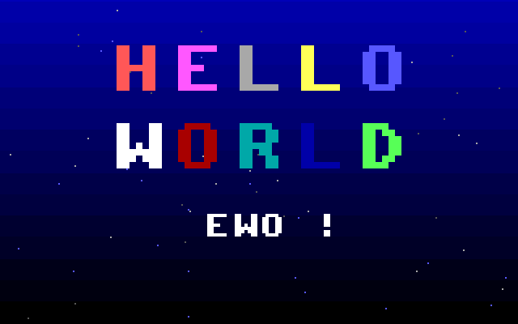

# 🚀 NewOS (MyQwen-OS)

<p align="center">
  <em>一个从零开始、纯手写的 32 位 x86 微型操作系统</em><br>
  <em>从 512 字节引导扇区到"在自制 OS 里写 C、编译、运行"</em>
</p>

<p align="center">
  
</p>

NewOS 是一个教学用途的 32 位 x86 操作系统，用 C 和少量汇编从零编写，在 QEMU 中运行。它走完了操作系统学习的完整链路：**引导 → 保护模式 → 中断 → 内存管理 → 多任务 → 图形 → 文件系统 → 编辑器 → C 编译器**——最终你可以在它里面用自带的编辑器写 C 程序、用自带的编译器编译、直接运行。

## ✨ 核心特性

### 🖥️ 底层基础
- **引导加载器**：512 字节手写引导扇区，从软盘加载内核（100KB 上限，含 64KB 段回绕处理）
- **保护模式**：GDT 段机制、A20 门、32 位保护模式切换
- **内存管理**：位图物理页分配器（含连续多页分配 `alloc_pages`）+ 分页（32MB 恒等映射）
- **中断系统**：完整 IDT、8259A PIC 重映射、PS/2 键盘中断驱动
- **实模式往返**：随时降级回实模式调 BIOS（切视频模式），用完自动回保护模式——跳板寄存器全套保存恢复

### ⏱️ 多任务与设备
- **抢占式多任务**：PIT IRQ0（18.2Hz）时间片轮转，协作式/抢占式统一上下文帧可互恢复，带"恶霸任务"演示
- **设备驱动**：VGA 文本/图形、串口 COM1、PS/2 键盘、PIT 定时器、PC 扬声器蜂鸣
- **图形库**：模式 13h（320×200×256）调色板/画点/矩形/精灵/字体
- **🎨 可调字体**：纯 VGA 硬件编程加载 **Terminus** 位图字体（写字符发生器平面 2 + CRTC 行高重配），`font` 命令三档字号（25/28/33 行），每次加载硬件级自测

### 📁 文件系统
xv6 风格教学实现（内存文件系统，1MB/256 块，64 inode）：
- 超级块 + inode/块位图 + 64 字节 inode（12 直接块，文件最大 48KB）
- 目录项链式存储、`.`/`..` 真实目录项、绝对/相对路径统一解析
- Shell 命令：`pwd` `ls` `cd` `mkdir` `touch` `cat` `rm` `echo >` `df`，提示符实时显示当前目录
- 删除保护（不能删 cwd/祖先）、开机自测（创建→写→读回→删除全流程验证）

### ✏️ 内置编辑器
nano 风格的 `edit` 命令：
- 方向键/Home/End/PgUp/PgDn 导航、插入/退格/删除/换行、Tab 展开
- **Ctrl+S 保存、Ctrl+X 退出**（修改未保存时二次确认）
- 底部反显状态栏（文件名/行列号/[M] 标记）、光标格高亮、长行水平滚动
- 自己轮询 8042 并跟踪 Shift/Ctrl/Caps/0xE0 扩展键前缀

### ⚙️ C 编译器（c4 移植）
`cc` 命令——**C in four functions**（Robert Swierczek）移植，编译 C 子集到内置栈式虚拟机执行：

| 支持 | 说明 |
|---|---|
| 类型 | `char`、`int`、指针、一维数组、`enum`、`sizeof` |
| 语句 | `if/else`、`while`、`return`、表达式、函数调用（含递归） |
| 注释 | `//` 和 `/* */` |
| 内建 | `printf` `open` `read` `close` `malloc` `free` `memset` `memcmp` `exit` |
| 不支持 | struct/union、float、for/do/switch、break/continue、预处理 |

**`open/read` 对接本 OS 文件系统**——C 程序能直接读取 OS 里的文件！编译错误带行号，死循环可 ESC 中断。

### 🎮 娱乐与应用
- **俄罗斯方块**：7-bag 随机、wall kick、锁定延迟、暂存、消行动画、5 套主题、蜂鸣音效
- **超级马里奥**：16×16 图块横版跳跃（卷轴镜头+视差背景、8.8 定点物理、板栗仔、金币/问号块/水管/旗杆）
- **🚀 开机画面**：深蓝渐变星空（DAC 调色板编程）+ 32px 彩色 "HELLO WORLD" 逐字揭示动画 + "NEWOS!" 副标题，任意键跳过，`splash` 命令可重放

## 💻 命令参考

| 命令 | 说明 |
|---|---|
| `help` | 显示所有命令 |
| `clear` | 清屏 |
| `meminfo` | 内存统计（页） |
| `echo [text]` | 打印文本；`echo text > file` 写入文件（覆盖） |
| `date` | CMOS 实时时钟 |
| `version` / `reboot` | 版本 / 重启 |
| `ps` / `start` / `stop` | 任务状态 / 启停多任务演示 |
| `testmode` | 图形模式实模式往返测试 |
| `tetris` / `mario` | 游戏（ESC 退出） |
| `font 12\|14\|16` | 字号切换（33/28/25 行） |
| `pwd` | 打印当前目录 |
| `ls [dir]` | 列出目录（`<DIR>` 标记目录） |
| `cd [dir]` | 切换目录（无参数回根目录） |
| `mkdir dir` | 创建目录 |
| `touch file` | 创建空文件 |
| `cat file` | 查看文件内容 |
| `rm path` | 删除文件或空目录 |
| `df` | 文件系统用量 |
| `edit file` | 打开编辑器（^S 保存 ^X 退出） |
| `cc file.c [args...]` | 编译并运行 C 程序（参数传给 main） |
| `splash` | 重放开机画面 |

## 🚀 快速开始

**环境要求**（Arch Linux）：`nasm` `gcc`（32 位支持）`ld` `objcopy` `qemu-system-i386`

```bash
make          # 构建 build/os.img
make run      # QEMU 运行 (串口输出到终端)
make debug    # QEMU + GDB 源码级调试 (端口 1234)
make clean    # 清理
```

开机后约 4 秒开机画面（任意键跳过），进入 Shell：

```
OS:/> help
```

## 📝 典型工作流

```
OS:/> mkdir src
OS:/> cd src
OS:/src> edit hello.c          ← 编辑器写 C 程序
OS:/src> cc hello.c            ← 编译并运行
hello from C! (42)
exit(0) cycle = 11
```

更酷的：C 程序读 OS 自己的文件系统——

```c
int main() { int fd; char *buf; int n;
fd = open("/data.txt", 0); buf = malloc(32);
n = read(fd, buf, 31); buf[n] = 0;
printf("read %d: %s\n", n, buf); return 0; }
```

## 🧪 自动化测试

5 套串口驱动的无头测试（QEMU monitor 注入按键 + 内核串口标记断言），**共 140 项**：

```bash
python3 tools/test-splash.py   # 开机画面 (14 项)
python3 tools/test-font.py     # 字体/字号 (23 项)
python3 tools/test-fs.py       # 文件系统 (39 项)
python3 tools/test-edit.py     # 编辑器   (38 项)
python3 tools/test-cc.py       # C 编译器 (26 项)
```

## 📂 目录结构

```
.
├── boot/boot.asm       # 512 字节引导扇区
├── kernel/             # 内核源码 (C + 汇编)
│   ├── kernel.c        # 内核入口
│   ├── memory.c/h      # 位图物理内存分配
│   ├── paging.c/h      # 分页
│   ├── idt.c/h pic.c   # 中断与 8259A
│   ├── irq.asm         # IRQ 汇编桩
│   ├── keyboard.c      # PS/2 键盘
│   ├── timer.c/h       # PIT 滴答 + 蜂鸣
│   ├── vga.c/h         # 文本模式显示
│   ├── graphics.c/h    # 模式 13h 图形库
│   ├── font.c/h        # VGA 字符发生器字体管理
│   ├── font12/14/16.h  # Terminus 字体数据
│   ├── fs.c/h          # 内存文件系统
│   ├── editor.c/h      # 内置编辑器
│   ├── cc.c/h          # c4 编译器移植
│   ├── splash.c/h .asm # 开机画面
│   ├── tetris.c/h      # 俄罗斯方块
│   ├── mario.c/h       # 超级马里奥
│   ├── task.c/h switch.asm   # 多任务
│   ├── realmode.c/h rm_*.asm  # 实模式往返跳板
│   └── keymap.h string.h      # 扫描码映射 / 字符串工具
├── tetris/             # 原始实模式汇编版 (移植蓝本)
├── tools/              # 字体转换 + 5 套测试脚本
├── note/               # 开发记录 + 截图
└── Makefile
```

## 📖 项目历程

| 里程碑 | 内容 |
|---|---|
| 1 | 实模式往返（BIOS 调用 + 图形模式） |
| 2 | 俄罗斯方块（汇编 1:1 移植 C） |
| 3 | 抢占式多任务（PIT IRQ0 时间片） |
| 4 | 超级马里奥（横版跳跃 + 卷轴） |
| 5 | Terminus 字体 + 三档字号（纯 VGA 硬件编程） |
| 6 | 内存文件系统 + 9 个文件命令 |
| 7 | nano 风格内置编辑器 |
| 8 | c4 迷你 C 编译器（写 C → 编译 → 运行闭环） |
| 9 | 开机画面（用户 hello.asm 的 32 位移植美化版） |

每个里程碑的开发过程、踩坑记录与修复思路详见 `note/` 目录下的开发记录。

## 📄 致谢

- **c4**（C in four functions）编译器：Robert Swierczek 原创（public domain），本项目为其内核内移植
- **Terminus Font**：Dimitar Zhekov 的经典终端位图字体
- 早期学习规划与笔记见本仓库 `LEARNING_PLAN.md` / `ROADMAP.md` / `docs/`

> 本项目为个人学习项目，代码以教学可读性优先。欢迎参考、批评、交流。
