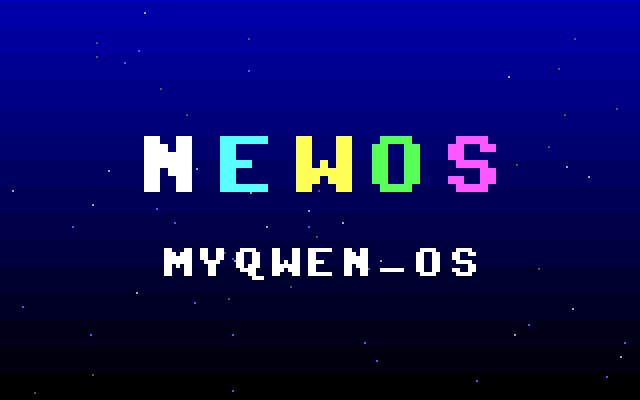
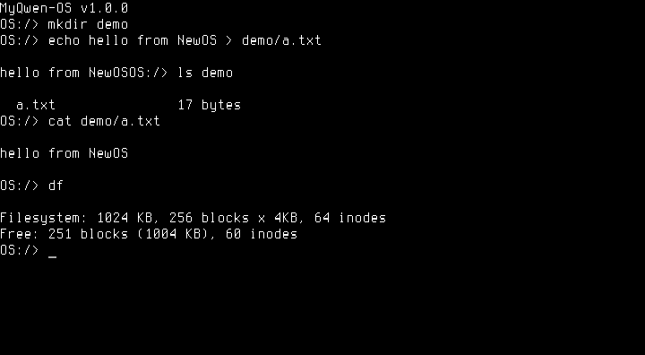
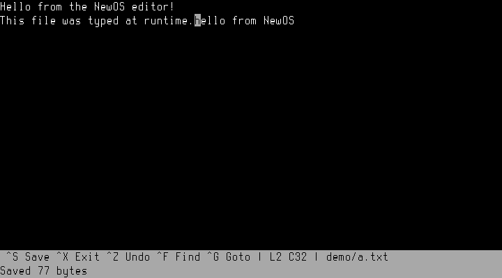
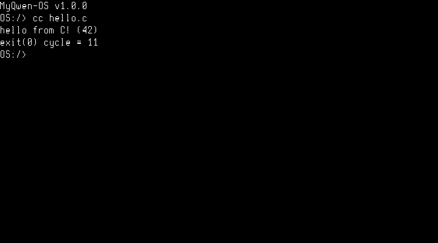
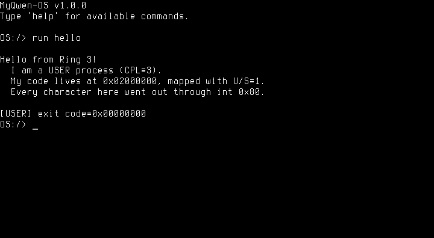
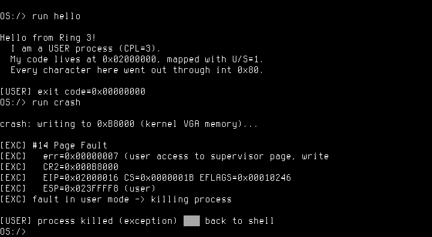
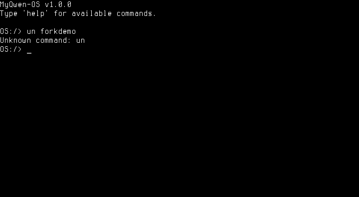
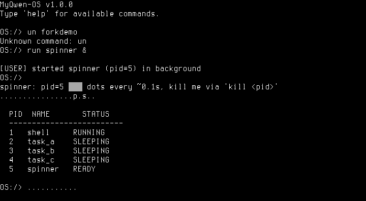
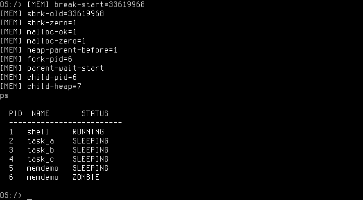
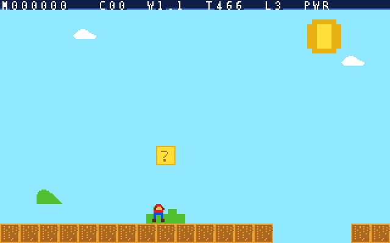

# 🚀 NewOS

<p align="center">
  <em>一个从零开始、纯手写的 32 位 x86 微型操作系统</em><br>
  <em>从 512 字节引导扇区到"在自制 OS 里写 C、编译、运行"</em>
</p>

<p align="center">
  <a href="README.en.md">English</a> · 中文
</p>

<p align="center">
  
  
  
  
</p>

<p align="center">
  
</p>

NewOS 是一个教学用途的 32 位 x86 操作系统，用 C 和少量汇编从零编写，在 QEMU 中运行。它走完了操作系统学习的完整链路：**引导 → 保护模式 → 中断 → 内存管理 → 多任务 → 图形 → 持久化文件系统 → 编辑器 → C 编译器 → Ring 3 用户态 → 用户态 Shell**——最终你可以在它里面写、编译、运行 C 程序，从 `/bin` 加载 flat 或 ELF32 程序，通过 `fork/waitpid/execve` 管理进程，并使用管道、重定向和后台任务。文件、目录和 `/bin` 会跨重启保留。

## ✨ 核心特性

### 🖥️ 底层基础
- **引导加载器**：512 字节手写引导扇区，从软盘加载内核（448KB 加载窗口，含 64KB 段回绕处理）
- **保护模式**：GDT 段机制、A20 门、32 位保护模式切换
- **内存管理**：BIOS E820 内存地图解析 + 保留区保护位图 + 物理页分配器与引用计数 + 内核 `kmalloc/kfree/krealloc` 堆 + 32MB 恒等映射分页
- **按进程虚拟内存**：独立页目录/页表、首次访问补零页、fork COW、栈 guard page、`brk` 堆收缩与匿名 `mmap` 窗口
- **可执行文件与进程模型**：`/bin` 同时支持 flat 和 ELF32；解析 PT_LOAD、数据段与 BSS，构造 `argc/argv/envp` 初始栈；`fork/waitpid/execve` 提供完整父进程收尸和事务式进程替换
- **中断系统**：完整 IDT（32 个异常处理器 + IRQ + 系统调用门）、8259A PIC 重映射、PS/2 键盘中断驱动
- **实模式往返**：随时降级回实模式调 BIOS（切视频模式），用完自动回保护模式——跳板寄存器全套保存恢复

### 🛡️ Ring 3 用户态
- **特权级隔离**：TSS 内核栈切换、用户代码/数据段（DPL3）、页表 U/S 位保护——用户程序碰内核内存直接 #PF
- **系统调用**：`int 0x80`（门 DPL3）——putc/puts/get_ticks/exit/fork/waitpid/getpid/sleep/brk/mmap/execve/open/read/write/close/lseek/chdir/getcwd/mkdir/pipe/dup/dup2/remove/readdir/setpgid/tcsetpgrp/kill，内核逐页校验用户传入的指针
- **独立用户态 Shell**：`run sh` 启动；支持 `/bin` PATH 查找、四段管道、`<`/`>`/`>>`、进程组、Ctrl+C/Ctrl+Z、后台 `&` 与 `jobs/fg/bg/kill/wait`
- **异常处理**：32 个异常处理器打印完整现场（EIP/CS/EFLAGS/ESP/CR2 + 页错误码 P/W/U 位解读），用户态异常杀进程回 shell，内核态异常 panic
- **20 个 flat 程序 + 1 个 ELF32 演示程序**：覆盖用户 Shell、共享打开文件、管道、waitpid、execve、ELF32、fork 堆隔离、空闲链表 allocator 和每进程工作目录

### ⏱️ 多任务与设备
- **抢占式多任务**：PIT IRQ0（18.2Hz）时间片轮转，协作式/抢占式统一上下文帧可互恢复，带"恶霸任务"演示
- **完整进程生命周期**：独立页目录与地址空间、fork、进程组、RUNNING/STOPPED 作业、`ps`/`kill`、孤儿僵尸回收；每进程拥有 16 项 fd 表和独立 CWD，暂停时保留全部 VM/fd 状态
- **设备驱动**：ATA PIO 磁盘、VGA 文本/图形、串口 COM1、PS/2 键盘、PIT 定时器、PC 扬声器蜂鸣
- **图形库**：模式 13h（320×200×256）调色板/画点/矩形/精灵/字体
- **🎨 可调字体**：纯 VGA 硬件编程加载 **Terminus** 位图字体（写字符发生器平面 2 + CRTC 行高重配），`font` 命令五档字号（12/14/16/18/20 → 33/28/25/22/20 行，默认 18；18/20 由 8x16 垂直放大生成），每次加载硬件级自测

### 📁 文件系统
xv6 风格教学实现（ATA PIO 持久化磁盘，1MB/256 块，64 inode）：
- 超级块 + inode/块位图 + 64 字节 inode（12 直接块，文件最大 48KB）
- 目录项链式存储、`.`/`..` 真实目录项、绝对/相对路径统一解析
- Shell 命令：`pwd` `ls` `cd` `mkdir` `touch` `cat` `rm` `echo >` `df`，提示符实时显示当前目录
- 超级块魔数/位图/块引用挂载检查、分配计数自动修复、写穿式 4KB 块缓存
- 删除保护（不能删 cwd/祖先）、重启持久化回归、开机自测（创建→写→读回→删除全流程验证）

### ✏️ 内置编辑器
nano 风格的 `edit` 命令：
- 方向键/Home/End/PgUp/PgDn 导航、Ctrl+方向键按词移动、Ctrl+Backspace 按词删除
- **Ctrl+Z/Ctrl+Y 撤销重做**、**Ctrl+F 搜索**、**Ctrl+G 跳行**
- **Ctrl+S 保存、Ctrl+X 退出**（修改未保存时可选保存、丢弃或取消）
- 精确定位光标格（修复换行残影）、底部状态栏、长行水平滚动
- 自己轮询 8042 并跟踪 Shift/Ctrl/Caps/0xE0 扩展键前缀

### ⚙️ C 编译器（c4 移植）
`cc` 命令——**C in four functions**（Robert Swierczek）移植，编译 C 子集到内置栈式虚拟机执行：

| 支持 | 说明 |
|---|---|
| 类型 | `char`、`int`、指针、一维数组、`enum`、`sizeof` |
| 声明 | 可带初始化：`int a = 5;`（全局/局部均支持，全局初始化在进入 main 前执行） |
| 语句 | `if/else`、`while`、`do/while`、`for`、`break/continue`、`return`、表达式、函数调用（含递归） |
| 注释 | `//` 和 `/* */` |
| 内建 | `printf` `open` `read` `close` `malloc` `free` `memset` `memcmp` `exit` |
| 不支持 | struct/union、float、switch、goto、预处理；for 增量/全局初始化表达式里勿用 `&&` `\|\|` `?:`（代码暂存后拷回的局限） |

**`open/read` 对接本 OS 文件系统**——C 程序能直接读取 OS 里的文件！编译错误带行号，死循环可 ESC 中断。

### 🎮 娱乐与应用
- **俄罗斯方块**：7-bag 随机、wall kick、锁定延迟、暂存、消行动画、5 套主题、蜂鸣音效
- **超级马里奥**：双主题关卡、超级/星星能力、检查点、连踩计分、可变跳跃、跳跃缓冲/Coyote time、粒子与震屏、中途重试和精致 HUD
- **🚀 开机画面**：深蓝渐变星空（DAC 调色板编程）+ 32px 彩色 "HELLO WORLD" 逐字揭示动画 + "NEWOS!" 副标题，任意键跳过，`splash` 命令可重放

## 💻 命令参考

| 命令 | 说明 |
|---|---|
| `help` | 显示所有命令 |
| `clear` | 清屏 |
| `meminfo` | 内存统计（页） |
| `memmap` | 显示 BIOS E820 内存地图和各区域类型 |
| `heap` | 内核堆统计与完整性检查 |
| `heap blocks` | 显示堆块分裂/合并后的块列表 |
| `heaptest` | 运行分配、重分配、释放和块合并压力测试 |
| `echo [text]` | 打印文本；`echo text > file` 写入文件（覆盖） |
| `date` | CMOS 实时时钟 |
| `version` / `reboot` | 版本 / 重启 |
| `ps` / `start` / `stop` | 任务状态 / 启停多任务演示 |
| `testmode` | 图形模式实模式往返测试 |
| `tetris` / `mario` | 游戏（ESC 退出） |
| `font 12\|14\|16\|18\|20` | 字号切换（33/28/25/22/20 行，默认 18） |
| `pwd` | 打印当前目录 |
| `ls [dir]` | 列出目录（`<DIR>` 标记目录） |
| `cd [dir]` | 切换目录（无参数回根目录） |
| `mkdir dir` | 创建目录 |
| `touch file` | 创建空文件 |
| `cat file` | 查看文件内容 |
| `rm path` | 删除文件或空目录 |
| `df` | 文件系统用量 |
| `edit file` | 打开编辑器（^S 保存，^X 退出时询问保存） |
| `cc file.c [args...]` | 编译并运行 C 程序（参数传给 main） |
| `run prog [args] [&]` | 运行内嵌或 `/bin` 程序；参数进入初始用户栈，& = detached 后台任务 |
| `run sh` | 进入用户态 Shell（`exit` 返回内核 Shell） |
| `splash` | 重放开机画面 |

## 🚀 快速开始

**环境要求**（Arch Linux）：`nasm` `gcc`（32 位支持）`ld` `objcopy` `qemu-system-i386`

```bash
make          # 构建 build/os.img
make run      # QEMU 运行；build/disk.img 保存持久化文件系统
make debug    # QEMU + GDB 源码级调试 (端口 1234)
make clean    # 清理
```

开机后约 4 秒开机画面（任意键跳过），进入 Shell：

```
OS:/> help
```

## 📝 典型工作流

```
OS:/> mkdir src
OS:/> cd src
OS:/src> edit hello.c          ← 编辑器写 C 程序
OS:/src> cc hello.c            ← 编译并运行
hello from C! (42)
exit(0) cycle = 11
```

更酷的：C 程序读 OS 自己的文件系统——

```c
int main() { int fd; char *buf; int n;
fd = open("/data.txt", 0); buf = malloc(32);
n = read(fd, buf, 31); buf[n] = 0;
printf("read %d: %s\n", n, buf); return 0; }
```

## 📷 截图

| 文件系统操作 | 内置编辑器 | C 编译运行 |
|---|---|---|
|  |  |  |

| Ring 3 用户态 | 用户态越界被内核抓获 |
|---|---|
|  |  |

| fork 独立地址空间 (子改 200 父仍 100) | 后台进程 + ps 进程表 |
|---|---|
|  |  |

| 用户堆 + fork 堆隔离 + waitpid |
|---|
|  |

| 超级马里奥标题 | 超级马里奥游戏画面 |
|---|---|
|  |  |

## 🧪 自动化测试

19 套串口驱动的无头测试（QEMU monitor 注入按键 + 内核串口标记断言），**文档统计 554 项**：

```bash
python3 tools/test-memory.py  # E820 + 页分配 + 内核堆 (15 项)
python3 tools/test-splash.py   # 开机画面 (14 项)
python3 tools/test-font.py     # 字体/字号 (30 项)
python3 tools/test-fs.py       # 文件系统 (43 项)
python3 tools/test-disk.py     # ATA/挂载/重启持久化 (19 项)
python3 tools/test-edit.py     # 编辑器/撤销/搜索/光标 (67 项)
python3 tools/test-cc.py       # C 编译器 (41 项)
python3 tools/test-preempt.py  # 抢占调度 (7 项)
python3 tools/test-mario.py    # 马里奥/道具/界面/双主题 (18 项)
python3 tools/test-user.py     # Ring 3 用户态 (36 项)
python3 tools/test-sched.py    # PCB 调度器 + 键盘缓冲 (15 项)
python3 tools/test-proc.py     # 多进程/fork/后台/kill (36 项)
python3 tools/test-memproc.py  # 用户堆/fork 隔离/waitpid (26 项)
python3 tools/test-alloc.py    # 空闲链表/合并/realloc (24 项)
python3 tools/test-vm.py       # 按需分页/COW/guard/brk/mmap (22 项)
python3 tools/test-exec.py     # 文件加载/exec/失败回滚 (26 项)
python3 tools/test-process.py  # waitpid/argv/envp/ELF32 (39 项)
python3 tools/test-fd.py       # fd/CWD/共享偏移/pipe/dup2 (42 项)
python3 tools/test-shell.py    # Shell/管道/进程组/暂停恢复/作业 (59 项)
```

> test-preempt / test-mario 是附着式测试（argv[1]=monitor socket），请用
> `python3 tools/run-attached-tests.py` 启动（自动起 QEMU → 等开机画面结束 → 依次运行）。

## 📂 目录结构

```
.
├── boot/boot.asm       # 512 字节引导扇区
├── kernel/             # 内核源码 (C + 汇编)
│   ├── kernel.c        # 内核入口
│   ├── memory.c/h      # E820 解析 + 保留保护 + 物理页分配
│   ├── heap.c/h        # 内核堆：分裂、合并、重分配、完整性检查
│   ├── paging.c/h      # 页目录/页表、恒等映射与用户映射原语
│   ├── ata.c/h         # ATA PIO 28-bit LBA 扇区读写
│   ├── vm.c/h          # 独立进程地址空间、按需分页、COW、brk/mmap
│   ├── exec.c/h        # /bin 发布、flat 加载器、事务式 exec
│   │                    # (vm.c/h 同时包含 ELF32 loader 与初始栈)
│   ├── gdt.c/h         # 内核 GDT (用户段 + TSS)
│   ├── idt.c/h pic.c   # 中断与 8259A
│   ├── irq.asm         # IRQ 汇编桩
│   ├── exc.c exc_asm.asm    # 异常处理器 (32 个向量)
│   ├── user.c/h user_asm.asm user_progs.c user_embed.asm  # Ring 3 用户态
│   ├── keyboard.c      # PS/2 键盘
│   ├── timer.c/h       # PIT 滴答 + 蜂鸣
│   ├── vga.c/h         # 文本模式显示
│   ├── graphics.c/h    # 模式 13h 图形库
│   ├── font.c/h        # VGA 字符发生器字体管理
│   ├── font12/14/16.h  # Terminus 字体数据
│   ├── fs.c/h          # 持久化文件系统、挂载检查与写穿块缓存
│   ├── fd.c/h          # 共享打开文件对象、pipe 环形缓冲区、引用计数
│   ├── editor.c/h      # 内置编辑器
│   ├── cc.c/h          # c4 编译器移植
│   ├── splash.c/h .asm # 开机画面
│   ├── tetris.c/h      # 俄罗斯方块
│   ├── mario.c/h       # 超级马里奥
│   ├── task.c/h switch.asm   # 多任务
│   ├── realmode.c/h rm_*.asm  # 实模式往返跳板
│   └── keymap.h string.h      # 扫描码映射 / 字符串工具
├── user/               # 用户态演示程序 (宿主 gcc 编译后 incbin 进内核)
│   ├── lib.h           # 系统调用封装 (int 0x80)
│   ├── linker.ld       # 链接到 0x2000000 (用户区)
│   └── hello.c count.c crash.c div0.c echo.c badptr.c forkdemo.c
│       spinner.c vmtest.c vmguard.c execdemo.c execbad.c
│       waittest.c execargv.c elfdemo.c memdemo.c allocdemo.c
│       filedemo.c fdstdin.c sh.c fdpipe.c
├── tetris/             # 原始实模式汇编版 (移植蓝本)
├── tools/              # 字体转换 + 19 套测试脚本
├── note/               # 开发记录 + 截图
└── Makefile
```

## 📖 项目历程

| 里程碑 | 内容 |
|---|---|
| 1 | 实模式往返（BIOS 调用 + 图形模式） |
| 2 | 俄罗斯方块（汇编 1:1 移植 C） |
| 3 | 抢占式多任务（PIT IRQ0 时间片） |
| 4 | 超级马里奥（横版跳跃 + 卷轴） |
| 5 | Terminus 字体 + 三档字号（纯 VGA 硬件编程） |
| 6 | 内存文件系统 + 9 个文件命令 |
| 7 | nano 风格内置编辑器 |
| 8 | c4 迷你 C 编译器（写 C → 编译 → 运行闭环） |
| 9 | 开机画面（用户 hello.asm 的 32 位移植美化版） |
| 10 | Ring 3 用户态（TSS + 页表 U/S 保护 + int 0x80 系统调用 + 异常处理） |
| 11 | 多进程（PCB 调度器 + 键盘环形缓冲 + 每进程独立地址空间 + fork + 后台进程） |
| 12 | E820 内存地图 + 保留区保护 + 内核堆分配器 + `memmap`/`heap` 诊断 |
| 13 | 独立虚拟地址空间 + 按需分页 + fork COW + guard page + `brk`/`mmap` |
| 14 | `/bin` 可执行文件发布 + flat 加载器 + 事务式 `exec` + PID 保持 |
| 15 | `waitpid` + argv/envp 初始栈 + ELF32 PT_LOAD/BSS + 只读代码页 |
| 16 | 用户态空闲链表 allocator（首适配 + 分裂 + 相邻合并 + 堆尾收缩 + calloc/realloc） |
| 17 | 编辑器增强（光标残影修复 + 撤销重做 + 搜索跳行 + 按词导航） |
| 18 | 马里奥增强（双关卡、能力块、检查点、连踩、粒子震屏、精致 HUD） |
| 19 | 进程级 fd 表（open/read/write/close/lseek）+ 每进程 CWD + fd 0/1/2 |
| 20 | 用户态 Shell + echo/cat/ls/pwd/mkdir/rm + 共享文件对象 + pipe/dup2 + `<`/`>`/`>>`/`\|`/`&` |
| 21 | 四段管道 + 进程组 + 前台 Ctrl+C + `jobs/fg/kill/wait` + 后台作业回收 |
| 22 | TASK_STOPPED + SIGSTOP/SIGCONT + Ctrl+Z + `WUNTRACED` + `bg` + 暂停作业恢复 |
| 23 | ATA PIO + 磁盘超级块/inode/块位图 + 挂载检查 + 写穿缓存 + 重启持久化 |

每个里程碑的开发过程、踩坑记录与修复思路详见 `note/` 目录下的开发记录。

里程碑 12–15 的完整逐步教程见
[`docs/MILESTONE_12_E820_HEAP.md`](docs/MILESTONE_12_E820_HEAP.md) 与
[`docs/MILESTONE_13_VM.md`](docs/MILESTONE_13_VM.md)、
[`docs/MILESTONE_14_EXEC.md`](docs/MILESTONE_14_EXEC.md)、
[`docs/MILESTONE_15_PROCESS_ELF.md`](docs/MILESTONE_15_PROCESS_ELF.md)、
[`docs/MILESTONE_23_DISK_FS.md`](docs/MILESTONE_23_DISK_FS.md)。

## 📄 致谢

- **c4**（C in four functions）编译器：Robert Swierczek 原创（public domain），本项目为其内核内移植
- **Terminus Font**：Dimitar Zhekov 的经典终端位图字体
- 早期学习规划与笔记见本仓库 `LEARNING_PLAN.md` / `ROADMAP.md` / `docs/`

> 本项目为个人学习项目，代码以教学可读性优先。欢迎参考、批评、交流。
